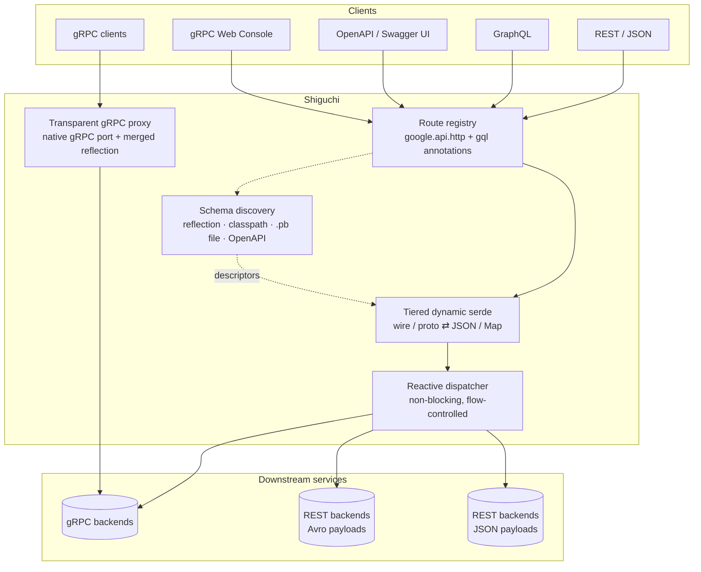

<p align="center">
  <picture>
    <source media="(prefers-color-scheme: dark)" srcset="docs/brand/shiguchi-lockup-stacked-dark.svg">
    
  </picture>
</p>

# Shiguchi: a gateway for gRPC services, for Spring Boot

[](https://github.com/appiaworks/shiguchi/actions/workflows/ci.yml)
[](https://central.sonatype.com/namespace/io.github.appiaworks)
[](LICENSE)

*Shiguchi* (仕口) is the Japanese carpenter's word for a joint where timbers meet at an angle and
lock together without nails. The mark is a *sanpō* joint, three beams meeting at one corner. That
is the project: one `.proto` contract meets REST, GraphQL and gRPC at the gateway, held together by
the schema itself rather than by glue code.

**Give your gRPC services a REST, GraphQL, and OpenAPI front door — without writing or
generating a single line of glue code.**

Add one starter, point it at a gRPC backend, and the gateway reads that service's schema at
startup — over gRPC server reflection, a classpath scan of compiled stubs, or a `.pb`
descriptor file — then serves it as REST/JSON, GraphQL, an OpenAPI 3 document with Swagger
UI, and a built-in web console for trying calls out. No stub generation step in the
gateway, no per-endpoint controllers, no schema kept in sync by hand. Add an RPC to your
proto and it shows up on every surface.

```yaml
shiguchi:
  services:
    - name: library-service
      host: localhost
      port: 9090
```

That is the whole configuration. `GET /v1/books/1`, `POST /graphql`, `/swagger-ui.html`,
and `/grpc-ui` all work against your existing service.

| Surface | Path | Module |
| --- | --- | --- |
| REST/JSON gateway | per-method HTTP routes | `shiguchi-*-starter` |
| GraphQL + Apollo Federation | `/graphql`, `/graphiql` | `shiguchi-graphql-*-starter` |
| OpenAPI 3 + Swagger UI | `/v3/api-docs`, `/swagger-ui.html` | `shiguchi-openapi-*-starter` |
| gRPC web console (try-it UI, [screenshots](docs/guides/ui.md)) | `/grpc-ui` | `shiguchi-ui-*-starter` |
| Pass-through gRPC proxy | `:9090` (configurable) | `shiguchi-grpc-proxy` |
| gRPC-Web for browser clients ([docs](docs/guides/grpc-web.md)) | `POST /<package.Service>/<Method>` | `shiguchi-*-starter` (`grpc-web.enabled`) |
| protovalidate request validation | (interceptor) | `shiguchi-validation-*-starter` |
| Avro, to REST backends and for REST callers ([docs](docs/guides/avro.md)) | `avro/binary` on gRPC-backed routes, `/avro/schemas` | `shiguchi-avro-*-starter` |

**Why it exists.** The usual alternatives are `protoc-gen-grpc-gateway` (a Go binary and a
codegen step wired into every build) or hand-written Spring controllers that wrap each RPC
and drift from the proto. This is a Spring Boot dependency instead: descriptor-driven at
runtime, on the reactive stack, with the transcoding hot path optimised down to
microseconds ([benchmarks](docs/concepts/performance.md)). Runs on Spring Boot 4.

> [!WARNING]
> **The gateway does not authenticate callers by default.** Out of the box it permits all
> requests at the transport layer and forwards bearer tokens / metadata to your backends.
> The embedded gRPC UI (`/grpc-ui`) can invoke **any** wired method. Before exposing the
> gateway outside a trusted network you **must** front it with authentication and review
> [SECURITY.md](SECURITY.md). Ship the UI disabled (`shiguchi.ui.enabled=false`) in
> production unless it is behind auth.

---

---

## Architecture



How a request flows through the serde tiers is documented in
[docs/concepts/transcoding.md](docs/concepts/transcoding.md).

---

## Quick start

Requires **JDK 21+** (generated serde tiers on 25+). Add the starter (Spring Boot 4):

```kotlin
dependencies {
    implementation("io.github.appiaworks:shiguchi-spring-boot4-starter:0.20.0")
}
```

Point it at a backend in `application.yml` (shown above) and run. One backend, four surfaces:

```bash
curl localhost:8080/v1/books/1
curl -X POST localhost:8080/graphql -H 'Content-Type: application/json'   -d '{"query":"{ books { books { title author } } }"}'
# /swagger-ui.html  and  /grpc-ui (when enabled)
```

Full steps (Maven, annotating protos, samples, building from source):
[docs/getting-started/quick-start.md](docs/getting-started/quick-start.md). A guided walk-through:
[docs/getting-started/tutorial.md](docs/getting-started/tutorial.md).

## Features

Schema discovery without codegen, REST/JSON transcoding, GraphQL with Apollo Federation, OpenAPI
and a web console, Cursus push messaging, security and rate limiting, resilience, caching,
metrics and tracing, a Helm chart and an OCI image. Each is described, with its options, in
[docs/getting-started/features.md](docs/getting-started/features.md) and the guides linked from [docs/README.md](docs/README.md).

## Security, performance, operations

- Secure by opt-in: [docs/guides/security.md](docs/guides/security.md), [SECURITY.md](SECURITY.md).
- Serde tiers and numbers: [docs/concepts/performance.md](docs/concepts/performance.md),
  [benchmarks](shiguchi-benchmarks/README.md).
- Metrics, tracing, access log: [docs/operations/observability.md](docs/operations/observability.md).
- Helm chart and image: [docs/operations/deployment.md](docs/operations/deployment.md).
- Spring Boot 4 only (0.18.x is the last Boot 3 line): [docs/operations/compatibility.md](docs/operations/compatibility.md).

---

## Documentation

**Start here**

- [docs/getting-started/tutorial.md](docs/getting-started/tutorial.md) — a gRPC backend to REST, GraphQL, OpenAPI and a console, one step at a time, with what each step actually did.
- [docs/operations/troubleshooting.md](docs/operations/troubleshooting.md) — symptoms and the exact messages: 404s, backends that will not load, JSON that looks wrong, startup failures.
- [docs/concepts/comparison.md](docs/concepts/comparison.md) — versus grpc-gateway (Go), proxy-based transcoders, plain SCG and hand-written controllers — including when to pick one of those.

**Everything else**

- [docs/README.md](docs/README.md) — every guide, grouped by task: shaping the API, other client surfaces, backends and traffic, security, push, production, the standalone libraries and the design notes.
- [shiguchi-benchmarks](shiguchi-benchmarks/README.md) — JMH suites and reference numbers.
- [SECURITY.md](SECURITY.md) — security model, default posture, vulnerability reporting.
- [CONTRIBUTING.md](CONTRIBUTING.md) — build, test, and PR guidelines.
- [CHANGELOG.md](CHANGELOG.md) — release history.

## Built on

This project exists because of the open source it builds on. The load-bearing ones:

| Project | Role here |
| --- | --- |
| [gRPC-Java](https://github.com/grpc/grpc-java) | Channels, server reflection, the proxy transport |
| [Protocol Buffers](https://github.com/protocolbuffers/protobuf) | Descriptors and dynamic messages — the basis of zero-codegen discovery |
| [Spring Boot](https://github.com/spring-projects/spring-boot) | Autoconfiguration and the starter model |
| [Spring Cloud Gateway](https://github.com/spring-cloud/spring-cloud-gateway) | Reactive route registry and filter chain |
| [Netflix DGS](https://github.com/Netflix/dgs-framework) + [graphql-java](https://github.com/graphql-java/graphql-java) | GraphQL surface and Apollo Federation |
| [springdoc-openapi](https://github.com/springdoc/springdoc-openapi) + [Swagger UI](https://github.com/swagger-api/swagger-ui) | OpenAPI 3 document and the Swagger surface |
| [Caffeine](https://github.com/ben-manes/caffeine) | Descriptor and marshaller caches on the hot path |
| [ClassGraph](https://github.com/classgraph/classgraph) | Classpath scan discovery mode |
| [protovalidate](https://github.com/bufbuild/protovalidate-java) | Request validation interceptor |
| [Micrometer](https://github.com/micrometer-metrics/micrometer) + [OpenTelemetry](https://github.com/open-telemetry/opentelemetry-java) | Metrics and distributed tracing |
| [React](https://github.com/facebook/react) + [Monaco Editor](https://github.com/microsoft/monaco-editor) | The embedded gRPC web console |

Full list with versions and license identifiers: [THIRD-PARTY.md](THIRD-PARTY.md).

## License

Copyright 2024 Shiguchi contributors.

Licensed under the [Apache License, Version 2.0](LICENSE). You may obtain a copy of the
License at <https://www.apache.org/licenses/LICENSE-2.0>.

Unless required by applicable law or agreed to in writing, software distributed under the
License is distributed on an "AS IS" BASIS, WITHOUT WARRANTIES OR CONDITIONS OF ANY KIND,
either express or implied.

The name "Shiguchi" and the logo are trademarks and are not licensed with the code; see
[TRADEMARKS.md](TRADEMARKS.md) for how you may use them.

Attribution notices for redistributed components are in [NOTICE](NOTICE); if you
redistribute this software or a derivative, Apache-2.0 §4 requires you to carry that file
along with the license. Contributions are accepted under the same license
([CONTRIBUTING.md](CONTRIBUTING.md)).
