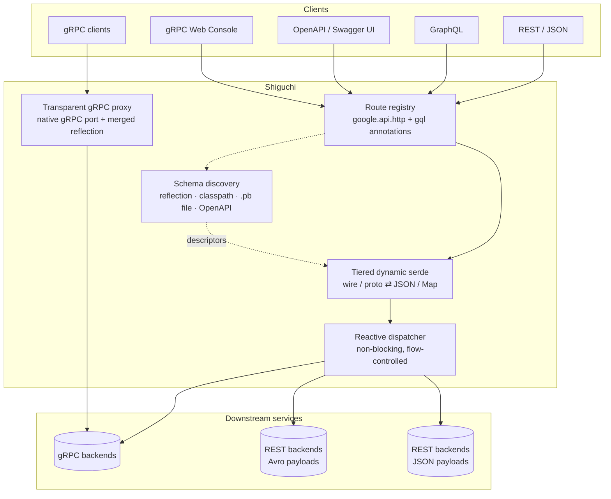
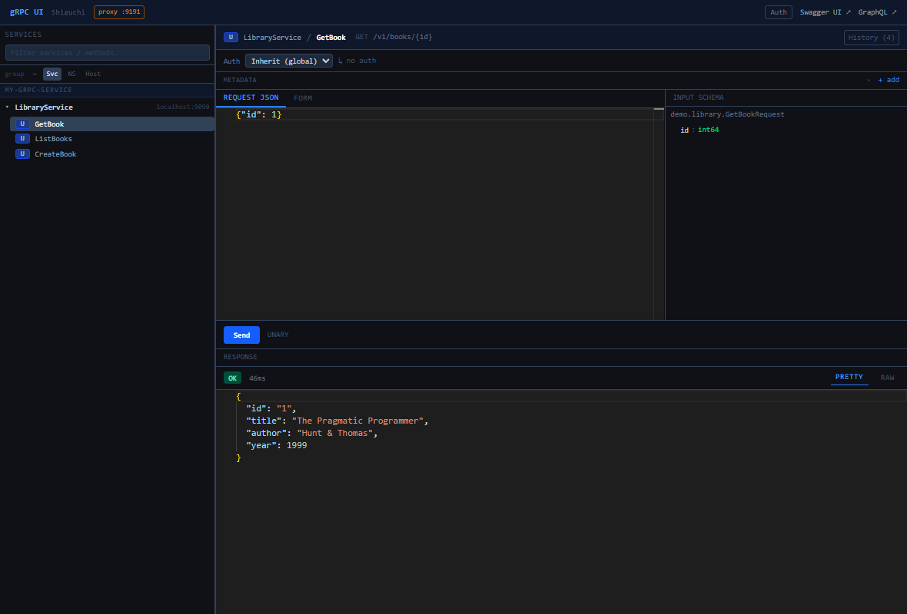

<p align="center">
  <picture>
    <source media="(prefers-color-scheme: dark)" srcset="docs/brand/shiguchi-lockup-stacked-dark.svg">
    
  </picture>
</p>

# Shiguchi: a gateway for gRPC services, for Spring Boot

[](https://github.com/appiaworks/shiguchi/actions/workflows/ci.yml)
[](https://central.sonatype.com/namespace/io.github.appiaworks)
[](LICENSE)

*Shiguchi* (仕口) is the Japanese carpenter's word for a joint where timbers meet at an angle and
lock together without nails. The mark is a *sanpō* joint, three beams meeting at one corner. That
is the project: one `.proto` contract meets REST, GraphQL and gRPC at the gateway, held together by
the schema itself rather than by glue code.

**Give your gRPC services a REST, GraphQL, and OpenAPI front door — without writing or
generating a single line of glue code.**

Add one starter, point it at a gRPC backend, and the gateway reads that service's schema at
startup — over gRPC server reflection, a classpath scan of compiled stubs, or a `.pb`
descriptor file — then serves it as REST/JSON, GraphQL, an OpenAPI 3 document with Swagger
UI, and a built-in web console for trying calls out. No stub generation step in the
gateway, no per-endpoint controllers, no schema kept in sync by hand. Add an RPC to your
proto and it shows up on every surface.

```yaml
shiguchi:
  services:
    - name: library-service
      host: localhost
      port: 9090
```

That is the whole configuration. `GET /v1/books/1`, `POST /graphql`, `/swagger-ui.html`,
and `/grpc-ui` all work against your existing service.

| Surface | Path | Module |
| --- | --- | --- |
| REST/JSON gateway | per-method HTTP routes | `shiguchi-*-starter` |
| GraphQL + Apollo Federation | `/graphql`, `/graphiql` | `shiguchi-graphql-*-starter` |
| OpenAPI 3 + Swagger UI | `/v3/api-docs`, `/swagger-ui.html` | `shiguchi-openapi-*-starter` |
| gRPC web console (try-it UI, [screenshots](docs/ui.md)) | `/grpc-ui` | `shiguchi-ui-*-starter` |
| Pass-through gRPC proxy | `:9090` (configurable) | `shiguchi-grpc-proxy` |
| gRPC-Web for browser clients ([docs](docs/grpc-web.md)) | `POST /<package.Service>/<Method>` | `shiguchi-*-starter` (`grpc-web.enabled`) |
| protovalidate request validation | (interceptor) | `shiguchi-validation-*-starter` |
| Avro, to REST backends and for REST callers ([docs](docs/avro.md)) | `avro/binary` on gRPC-backed routes, `/avro/schemas` | `shiguchi-avro-*-starter` |

**Why it exists.** The usual alternatives are `protoc-gen-grpc-gateway` (a Go binary and a
codegen step wired into every build) or hand-written Spring controllers that wrap each RPC
and drift from the proto. This is a Spring Boot dependency instead: descriptor-driven at
runtime, on the reactive stack, with the transcoding hot path optimised down to
microseconds ([benchmarks](#performance)). Runs on Spring Boot 3 and Boot 4.

> [!WARNING]
> **The gateway does not authenticate callers by default.** Out of the box it permits all
> requests at the transport layer and forwards bearer tokens / metadata to your backends.
> The embedded gRPC UI (`/grpc-ui`) can invoke **any** wired method. Before exposing the
> gateway outside a trusted network you **must** front it with authentication and review
> [SECURITY.md](SECURITY.md). Ship the UI disabled (`shiguchi.ui.enabled=false`) in
> production unless it is behind auth.

---

## Architecture



How a request flows through the serde tiers is documented in
[docs/transcoding.md](docs/transcoding.md).

---

## Features

### Schema discovery — no codegen in the gateway

- **Four discovery modes**, per service: `DYNAMIC` (gRPC server reflection), `STATIC`
  (compiled stubs on the classpath), `PB_FILE` (a `.pb` `FileDescriptorSet`), and
  `REST_DOWNSTREAM` (proxy an existing REST service under a path prefix, merge its OpenAPI
  document into the consolidated spec, and expose its operations as GraphQL queries and
  mutations derived from that document). A REST backend can be spoken to in **Avro**
  instead of JSON when its document advertises it ([docs/avro.md](docs/avro.md)).
- **Stub auto-discovery** in `STATIC` mode — ClassGraph classpath scan or Spring
  `BindableService` bean scan, optionally limited to given packages.
- **Service discovery and client-side load balancing** — `discovery-name` reaches a backend
  through Spring Cloud `DiscoveryClient` (Eureka/Consul/Kubernetes): every registered instance
  is an address of the channel, calls round-robin across them, the list follows the registry.
  Or `target: dns:///headless-svc:9090` for Kubernetes without Spring Cloud.
  → [docs/service-discovery.md](docs/service-discovery.md),
  [runnable sample](samples/sample-discovery-gateway)
- **Safe rolling deploys** — instances publish their version in registry metadata, and the
  gateway reads the schema from one pinned instance of the oldest running version (or the newest,
  or an exact one), so two versions side by side never mix or flip the served schema; the routes
  endpoint shows the schema's version and instances per version. `versions.traffic` splits
  calls between versions by weight for a gradual rollout, with an optional sticky header (one
  caller, one version) and a preview header (ask for a version before it gets any traffic).
  The `gateway-traffic` actuator endpoint changes the split at runtime and reports calls in
  flight per version, so you know when the old one is drained and safe to stop.
  `versions.rollout` automates it: a newly registered version is stepped up to every call, and
  rolled back at once when its error rate or p99 breaks the limits.
  → [docs/service-discovery.md](docs/service-discovery.md#rolling-deploys-and-versions)
- **Live refresh** — periodic re-discovery (`shiguchi.refresh.*`) plus an
  authenticated `gateway-refresh` actuator endpoint to re-read schemas on demand.
- **Method exposure filters** — `include-methods` / `exclude-methods` glob patterns hide
  RPCs from every HTTP surface. → [docs/configuration.md](docs/configuration.md)

### REST / JSON transcoding

- **`google.api.http` annotations** drive routes — verb, path template, `body` field,
  `additional_bindings`, dotted path variables like `{book.id}`. A method without the annotation
  has no REST route (it is still on GraphQL, the proxy and the console) unless you opt in to
  `shiguchi.rest.auto-mapping`, which gives it `POST /{package.Service}/{Method}`.
  → [docs/http-annotations.md](docs/http-annotations.md)
- **Binary bodies** with `google.api.HttpBody`: file downloads and uploads of any content type
  pass through as bytes, with path and query parameters still binding the rest of the request.
  → [docs/http-annotations.md](docs/http-annotations.md#binary-bodies-googleapihttpbody)
- **Full proto3 JSON mapping**: well-known types, `Any` via the discovered type registry,
   64-bit ints as strings, both camelCase and snake_case accepted on input. Response layout is
   configurable globally or per service (`shiguchi.json.print`): proto field names, enum
   numbers, omitted defaults, ECMAScript number layout. → [docs/json-types.md](docs/json-types.md#response-layout-print-options)
- **Dates as dates**: `google.type.Date`, `TimeOfDay`, `DateTime` and `Decimal` travel as ISO
  strings (`"2026-09-22"`, `"14:03:11"`, `"12.34"`) rather than `{year, month, day}` objects, in
  both directions and in query parameters. They are typed `LocalDate` / `LocalTime` /
  `Decimal` in GraphQL and `format: date` / `time` in OpenAPI, and ISO-8601 durations are
  accepted on input. Each one can be switched off. → [docs/json-types.md](docs/json-types.md)
- **Your own scalar types**: a `ProtoScalarCodec` bean writes any message of yours as one JSON
  value (`"sku":"AB-1234"`) on every surface, and `ProtoTypes` converts the well-known types to
  and from `java.time`, `BigDecimal` and friends. Both work from plain Java too.
  → [docs/json-types.md](docs/json-types.md#your-own-scalar-types),
  [docs/proto-serde-standalone.md](docs/proto-serde-standalone.md)
- **Server streaming** on every surface — NDJSON or Server-Sent Events (`Accept: text/event-stream`) on REST, GraphQL subscriptions over
  WebSocket (graphql-transport-ws), SSE in the console — flow-controlled end to end: a slow
  consumer backpressures the gRPC backend instead of buffering in the gateway, and a consumer
  that leaves cancels the backend call.
- **Client streaming on REST** — a client-streaming RPC bound with `post` takes an
  `application/x-ndjson` body, one JSON message per line, and answers with the backend's single
  response. The upload is never buffered whole, so it can exceed memory; the console sends a
  list of messages on one call. → [docs/http-annotations.md](docs/http-annotations.md)
- **Paging, sorting, and field projection by convention** — `page_request`, `sort_fields`,
  `read_mask`, and `page_info` fields activate `?pageSize`/`?pageToken`/`?sort=`/`?fields=`
  mapping and `X-Next-Page-Token` / `X-Total-Count` response headers, with no annotation.
  All of them are advertised in the generated OpenAPI document.
  → [docs/projections-paging-sorting.md](docs/projections-paging-sorting.md)
- **gRPC→HTTP status mapping** with a pluggable `GatewayErrorRenderer` for custom error
  bodies. **Rich error details** travel with the error: the `google.rpc.Status` details a
  backend attaches (`BadRequest` field violations, `ErrorInfo`, `RetryInfo`, its own types)
  become the `details` array of the REST body and the `extensions.details` of a GraphQL error,
  a `RetryInfo` becomes `Retry-After`, and a stream that fails after it started ends with an
  in-band `{"error": ...}` line. → [docs/error-handling.md](docs/error-handling.md)
- **Retries and circuit breaking per backend** — `services[].retry` becomes a gRPC service
  config on that backend's channel, so every attempt is re-resolved and re-balanced onto a
  healthy instance, and only methods that are safe to repeat (proto `idempotency_level`, or a
  GET/HEAD/OPTIONS binding) are retried, within a per-channel retry budget so an outage is not
  multiplied by `max-attempts`; `services[].hedging` instead resends a slow call and keeps the
  first answer, to cut tail latency. `services[].circuit-breaker` stops calling a backend
  that keeps failing and lets a trial call decide when to resume. `services[].max-concurrent-calls`
  sheds load past a cap with a fast 503 instead of queueing behind a slow backend, and
  `services[].channels` spreads calls over several connections; `services[].outlier-detection`
  ejects the one instance failing far more than its peers.
  → [docs/resilience.md](docs/resilience.md)
- **HTTP caching** — per-method `services[].cache` rules (or the proto's `(shiguchi.api.method).cache_ttl_seconds`)
  send `Cache-Control` that is `private` whenever the caller is identified, `Vary`, and a strong
  `ETag` with 304 on `If-None-Match`. With `rest.resource-etags` a resource's AIP-154 `etag` field
  is the `ETag`, and `If-Match` makes updates conditional: a stale tag is a 412.
  → [docs/caching.md](docs/caching.md)
- **Per-service path prefixes** so several backends coexist without route collisions.
- **Cross-backend merge** — one endpoint served by fanning out to N backends that return the same
  message type, merged into a single sorted, paged result. Backends that honour `sort_fields` are
  streamed with the sort pushed down; ones that do not are materialised and sorted in the gateway.
  → [docs/merging.md](docs/merging.md)

### GraphQL (Netflix DGS)

- **SDL generated from proto descriptors** at startup — queries, mutations, and
  subscriptions, with operation type inferred or set explicitly. `REST_DOWNSTREAM` services
  join the same schema: their OpenAPI operations become fields, dispatched over HTTP.
- **Server-streaming RPCs become GraphQL subscriptions**, demand-driven over the same
  flow-controlled path. Served over WebSocket (graphql-transport-ws) once you set
  `spring.graphql.websocket.path`, e.g. `/graphql/ws`; a subscriber that closes the socket
  cancels the backend stream.
- **Relay Connections** — a `page_info` field plus a repeated items field is exposed as
  `edges`/`node`/`pageInfo` with synthetic cursors, and `first`/`after`/`sort` arguments map
  onto the same `page_request` / `sort_fields` convention fields the REST surface uses.
- **Projection pushdown** — the selection set becomes a `google.protobuf.FieldMask` on the
  request *and* a conversion projection on the response, so the backend computes less and
  the gateway converts less.
- **Apollo Federation** — `@key` entity resolution with batched entity loaders.
- **Schema shaping** via `(shiguchi.api.graphql)` / `(shiguchi.api.graphql_field)` proto options or equivalent
  YAML `field-overrides` — renaming, required/ID marking, plucks, omissions, deprecations.
  → [docs/graphql-annotations.md](docs/graphql-annotations.md)

### Cursus: push (experimental)

- **Server-to-client messaging without a request** — clients subscribe to `namespace:name` topics
  over Server-Sent Events, WebSocket or a gRPC stream, backends publish over HTTP or gRPC
  (`shiguchi.cursus.v1.PushService`, also reachable as gRPC-Web and as JSON at `/push/v1/*`
  through the gateway's own transcoding), the gateway fans out. `AT_MOST_ONCE` or
  `AT_LEAST_ONCE` per namespace with history and `Last-Event-ID` resume, connection lifetime with
  jitter, per-namespace authorization (principal match, roles, JWT claim patterns, or your
  `GatewayAuthorizer`). Every namespace is also a GraphQL subscription field when the GraphQL
  surface is on; a server-streaming RPC with `(shiguchi.api.topic)` feeds its topics,
  one shared upstream stream per topic across instances; Kafka topics and backend streams as
  sources with a dead-letter queue; hooks that tell a backend when a topic gains or loses its
  subscribers; persistent sessions that resume from the subscriber's acknowledged cursor, and consumer groups
  for competing workers (per-key or single-active ordering, and an admin seek to replay from an id). In-memory, Redis, Postgres or any-SQL (JDBC, H2 included) engine, an archive with search, republish,
  tombstone, a per-subscriber delivery log and NDJSON export, presence and targeted `Send` to a principal, connection or device with per-connection delivery status,
  a `gateway-push` actuator endpoint and a console tab for operators;
  `shiguchi-cursus-*-starter`; a `cursus` command line (subscribe, publish, list, search, republish, tombstone, seek, send, bench; NDJSON, jbang or fat jar,
  [docs/push-cli.md](docs/push-cli.md)). Guide:
  [docs/push.md](docs/push.md), design: [docs/design/push.md](docs/design/push.md).

### OpenAPI & the web console

- **Consolidated OpenAPI 3 document** across every wired service, plus Swagger UI, with
  configurable security schemes so the Authorize dialog works.
- **Embedded gRPC web console** (`/grpc-ui`) — browse services and methods, edit requests in
  a Monaco editor, invoke unary and streaming calls, inspect metadata. Ships disabled.
  → [docs/ui.md](docs/ui.md)

### Performance & serde

- **Tiered serde** picks the cheapest path available: a descriptor-driven wire→JSON
  transcoder with no intermediate message object (Tier 0), generated parser plus a writer
  compiled for the stub class (Tier 1), generated per-type serializers (Tier 2),
  `JsonFormat` fallback (Tier 3). GraphQL skips JSON entirely with a proto⇄Map path.
- **Fully non-blocking dispatch** on the reactive stack — no thread is held during the
  backend round-trip.
- **Descriptor, marshaller, and serializer caches** (Caffeine) warmed at startup, so none of
  that work happens per request. → [docs/transcoding.md](docs/transcoding.md)
- **A response cache and request coalescing** for unary `GET`s — keyed per caller unless a rule
  declares the answer `PUBLIC`, looked up after authorization, with `stale-while-revalidate`,
  eviction on writes to the same path and on schema reload, `Cache-Status` on every answer, and a
  `gateway-cache` actuator endpoint. Identical concurrent requests share one backend call.
- **Gateway-side gzip** of REST bodies, with a tag per encoding and the compressed form kept in
  the cache; and a **GraphQL document cache plus automatic persisted queries** that skip parsing
  and validation and are emptied when the schema reloads. → [docs/caching.md](docs/caching.md)

### Security & hardening

- **Two modes**: `PERMIT_ALL` (default, warns at startup) or `AUTHENTICATED` (JWT required),
  with **per-surface overrides** so you can gate just the console and Swagger while REST
  stays open — or the reverse.
- **JWT resource-server integration** via standard Spring Security configuration.
  → [docs/security.md](docs/security.md)
- **Browser sign-in with a session cookie (BFF, experimental)** — `shiguchi-bff` signs users in
  at your OIDC provider, keeps their tokens server-side and sends the session's token to your
  backends. Cookie requests need an exact `Origin` match against the session's application (CSRF,
  WebSocket handshakes included), and no backend can set a cookie on the browser. Server-side
  sessions: Redis or a database for more than one instance.
  → [docs/bff.md](docs/bff.md) (guide), [docs/design/bff.md](docs/design/bff.md), [docs/security.md](docs/security.md)
- **TLS and mTLS to backends** — per-service trust store, client cert chain, and PKCS#8 key.
- **CORS** scoped to the browser surfaces by default, with REST routes deliberately excluded.
- **Security headers** on those same surfaces — a Content-Security-Policy fitted to the bundled
  console, GraphiQL and Swagger, plus `Referrer-Policy` and `Permissions-Policy`. Transcoded REST
  routes get none, since no browser renders them.
- **A request id on every request** — the caller's `X-Request-Id` or a fresh one — in the Reactor
  context, in SLF4J's MDC for your log pattern, echoed to the caller, and forwarded to backends.
- **protovalidate** constraint checking at the gateway (HTTP 400) or in an embedded gRPC
  server, logging violation paths but never field values. → [docs/validation.md](docs/validation.md)
- **Token-bucket rate limiting** — per caller (principal or client IP) on REST and GraphQL,
  in memory or shared through Redis across gateway instances, 429 with `Retry-After` and
  `X-RateLimit-*` headers before any backend is called; per method on the pass-through proxy.
  → [docs/rate-limiting.md](docs/rate-limiting.md)
- **Query and body bounds** — GraphQL depth and complexity limits
  (`shiguchi.graphql.limits.*`) reject abusive queries before any backend is called, and
  transcoded REST routes refuse request bodies over `shiguchi.rest.max-request-body`
  (4 MB) with 413 before parsing them. `shiguchi.rest.max-response-body` caps what goes back the
  same way (502 `RESPONSE_TOO_LARGE`), and `max-inbound-message-size` can be raised per backend. Opt in to
  `shiguchi.rest.request-validation.reject-unknown-query-parameters` and a query parameter
  that matches no request field (a typo like `?pageSzie=`) gets a 400 `BadRequest` instead of
  being ignored. → [docs/http-annotations.md](docs/http-annotations.md#unknown-query-parameters)

### Operations

- **Micrometer metrics** on every outbound call — `grpc.client.call.started` and
  `grpc.client.call.duration`, tagged by service, method, and status, plus per-method message
  counters for streaming volume.
- **Distributed tracing** — W3C/B3/request-id propagation by default; gRPC OTel client
  spans when an `OpenTelemetry` bean is present.
- **Access log** in `COMMON` or `JSON` form on a dedicated logger.
- **Header propagation** — `authorization` and `x-principal` always, plus any headers you
  list, copied onto outbound gRPC metadata; per-service static metadata too.
- **Deadlines and keepalive** — global and per-service unary deadlines (`DEADLINE_EXCEEDED`
  → HTTP 504), HTTP/2 keepalive tuning, inbound message size caps.
- **Health and readiness that follow the backends** — a `shiguchi` actuator health
  indicator lists every configured service (loaded or not, routes, channel state, last error),
  readiness stays `REFUSING_TRAFFIC` while backends are missing (policy: all, any, ignore), and
  missing backends are retried in the background until they load — or startup fails fast if
  you prefer. Configuration mistakes stop the application at bind time with the property path
  and the reason. → [docs/observability.md](docs/observability.md#health-and-readiness)
- **A `gateway-routes` actuator endpoint** answering the question behind most 404s — did this
  route load, and where does it go: every service with its load state and last error, and
  every route with its HTTP binding, GraphQL field, scopes and idempotency, read from the
  dispatcher's own registry. Plus gateway-state metrics (`gateway.routes`,
  `gateway.services.loads` tagged by phase and outcome, `gateway.discovery.instances`,
  descriptor cache hit rate) for the failures a health check reports as `UP` — a backend
  silently failing to reload, a route count that halves after a refresh.
  → [docs/observability.md](docs/observability.md#the-gateway-routes-endpoint)

### Packaging

- **Spring Boot 3 and Boot 4 starter lines** built from the same core, each shipping the
  matching third-party runtime ([compatibility matrix](#compatibility)).
- **A BOM** (`shiguchi-bom`) so consumers pin one version.
- **Helm chart** and an OCI sample image published on release. → [Deploy](#deploy)

Core modules (`io.github.appiaworks:*`):

- `shiguchi-core` — dynamic proto⇄JSON/Map serde, descriptor cache, routing, reflection client.
- `protobuf-java-extras` — the proto JSON serde, scalar codecs and type converters on their own:
  protobuf and `jackson-core` only, usable without the gateway.
- `protobuf-java-extras-classfile` — the code generator behind the compiled serde paths,
  written against the Class-File API and so compiled for Java 25. Found through
  `ServiceLoader`; on an older JVM it is never loaded and the library runs on its wire
  transcoder and reflective paths with the same output.
- `protoc-gen-java-extras` (+ `-gradle-plugin`) — a protoc plugin that adds `LocalDate`,
  `Instant`, `BigDecimal`... accessors to generated proto classes, and a `writeJson` /
  `mergeJson` pair that prints and parses them as proto JSON through their own getters and
  setters, on any Java. Also independent of the gateway.
- `shiguchi-rest` / `-graphql` / `-openapi` / `-grpc-proxy` / `-validation` — the surfaces.
- `shiguchi-proto` — the `.proto` files you can import: the `shiguchi/api/*.proto` options (GraphQL schema, method settings, merge, push topic)
  and `pagination.proto` (the paging/sorting message shapes). Shipped inside the jar and as a
  `protos` classifier zip for non-JVM toolchains; both are optional, since the conventions match
  on field names and the annotations can be replaced by YAML.
- `shiguchi-ui` + `shiguchi-ui-frontend` — the embedded React console.
- `spring-boot3/*` and `spring-boot4/*` — auto-configuration + starters for both Spring Boot lines.

---

## Quick start

Requirements: **JDK 21+**. The generated serde tiers (Tier 1 for compiled stubs, Tier 2 for
everything else) are built with the Class-File API and so switch on at **Java 25+** only; on
21–24 the gateway serves REST through the wire transcoder (Tier 0) and the GraphQL and request
paths through the reflective converter, with the same JSON. Stubs built with
[`protoc-gen-java-extras`](docs/protoc-java-extras.md#json) carry their Tier 1 writer and get it
on any Java. (Node 22+ only if rebuilding the UI frontend.)

### 1. Add a starter

> Releases are published to **Maven Central**: no extra repository configuration needed.

Gradle (Spring Boot 3):

```kotlin
dependencies {
    implementation("io.github.appiaworks:shiguchi-spring-boot3-starter:0.14.0")
    // optional surfaces:
    implementation("io.github.appiaworks:shiguchi-openapi-spring-boot3-starter:0.14.0")
    implementation("io.github.appiaworks:shiguchi-graphql-spring-boot3-starter:0.14.0")
    implementation("io.github.appiaworks:shiguchi-ui-spring-boot3-starter:0.14.0")
    implementation("io.github.appiaworks:shiguchi-avro-spring-boot3-starter:0.14.0")   // Avro to REST backends
}
```

Maven (Spring Boot 3):

```xml
<dependency>
  <groupId>io.github.appiaworks</groupId>
  <artifactId>shiguchi-spring-boot3-starter</artifactId>
  <version>0.14.0</version>
</dependency>
```

Gradle (Spring Boot 4) — same modules, `spring-boot4` artifact ids; the starter brings the
Boot-4-matched runtime line (Spring Cloud Gateway 5.0.x, springdoc 3.1.x, DGS 12.x):

```kotlin
dependencies {
    implementation("io.github.appiaworks:shiguchi-spring-boot4-starter:0.14.0")
    // optional surfaces:
    implementation("io.github.appiaworks:shiguchi-openapi-spring-boot4-starter:0.14.0")
    implementation("io.github.appiaworks:shiguchi-graphql-spring-boot4-starter:0.14.0")
    implementation("io.github.appiaworks:shiguchi-ui-spring-boot4-starter:0.14.0")
}
```

The `shiguchi.*` configuration is identical on both lines.

### 2. Point it at your gRPC services

`application.yml`:

```yaml
shiguchi:
  services:
    - name: library-service
      host: localhost
      port: 9090
      mode: DYNAMIC        # DYNAMIC (server reflection) | STATIC (classpath) | PB_FILE
  openapi:  { enabled: true }
  graphql:  { enabled: true }
  ui:       { enabled: false }   # enable only behind auth
```

### 3. Annotate your protos (optional but recommended)

Standard `google.api.http` bindings drive the REST routes; `(shiguchi.api.graphql)` refines the
GraphQL side (without it, methods still map by convention):

```protobuf
service LibraryService {
  rpc GetBook(GetBookRequest) returns (Book) {
    option (google.api.http) = { get: "/v1/books/{id}" };
  }
  rpc ListBooks(ListBooksRequest) returns (ListBooksResponse) {
    option (google.api.http) = { get: "/v1/books" };
    option (shiguchi.api.graphql) = { name: "books", type: QUERY };
  }
  rpc CreateBook(CreateBookRequest) returns (Book) {
    option (google.api.http) = { post: "/v1/books", body: "book" };
    option (shiguchi.api.graphql) = { name: "createBook", type: MUTATION };
  }
}
```

### 4. Run and call

```bash
./gradlew :samples:sample-rest-gateway:bootRun
```

One backend, four surfaces:

```bash
# REST — transcoded from the http annotations
curl localhost:8080/v1/books/1
# {"id":"1","title":"The Pragmatic Programmer","author":"Hunt & Thomas","year":1999}

# GraphQL
curl -X POST localhost:8080/graphql -H 'Content-Type: application/json' \
  -d '{"query":"{ books { books { title author } } }"}'

# OpenAPI spec + Swagger UI          gRPC console (when enabled)
open localhost:8080/swagger-ui.html  # localhost:8080/grpc-ui
```

---

## The gRPC web console

Every discovered method gets a try-it UI at `/grpc-ui` — no protoc, no grpcurl, no client
code ([full walkthrough with screenshots](docs/ui.md)):



- Service tree across all backends (group by service, namespace, or host) with filtering.
- Schema-aware JSON editor or field-by-field form, with the input message schema alongside.
- Per-call bearer auth and arbitrary gRPC metadata; response shows gRPC status, latency,
  and the decoded message; per-method call history for replay.
- The HTTP binding from `google.api.http` is shown for each method, and the header links
  to the same service's Swagger UI and GraphiQL views.

Disabled by default — it can invoke any wired method, so ship it behind auth
(`security.surfaces.ui.require-auth: true`; see [SECURITY.md](SECURITY.md)).

## Security

The gateway boots **open by default** (`security.mode: PERMIT_ALL`) so the try-it-now
surfaces work on first run, but it gives you three escalating ways to lock it down:

```yaml
shiguchi:
  security:
    mode: AUTHENTICATED          # require a valid JWT on every request
  ui:
    require-auth: true           # or: just gate the gRPC console
spring:
  security:
    oauth2:
      resourceserver:
        jwt:
          issuer-uri: https://your-idp.example.com   # required by both options above
```

- **`security.mode: PERMIT_ALL`** (default) — bootable with no IdP. Still protects the two
  dangerous surfaces: the `gateway-refresh` actuator endpoint always requires auth, and the
  gRPC console API is gated when `ui.require-auth: true`. A loud WARN is logged at startup.
- **`security.mode: AUTHENTICATED`** — every request needs a valid JWT (OAuth2 resource
  server). Fails fast at startup if no `issuer-uri`/JWT decoder is configured, so you never
  get a silent "401 everything."
- **Per-surface control** — `security.surfaces.{ui,graphql,openapi,rest}.require-auth`
  gates browser-facing surfaces while machine-facing REST stays open (or the reverse),
  and `shiguchi.cors.*` enables CORS on exactly the browser surfaces.
- **Bring your own** — define a `SecurityWebFilterChain` bean and it fully replaces the
  default (works in both Spring Boot 3 and 4).

Per-route scopes from your proto annotations are enforced automatically. Setting up the JWT
decoder, mapping claims to scopes, TLS to backends and bringing your own chain are in
[docs/security.md](docs/security.md); see
[SECURITY.md](SECURITY.md) for the full model.

## Try the samples

Self-contained example apps under [`samples/`](samples):

| Sample | What it shows |
| --- | --- |
| `sample-rest-gateway` | Minimal REST/JSON gateway |
| `sample-graphql-gateway` | GraphQL + federation |
| `sample-grpc-proxy` | Pass-through gRPC proxy |
| `sample-grpc-ui-standalone` | Just the gRPC web console |
| `sample-rest-downstream` | A REST (non-gRPC) backend aggregated via `REST_DOWNSTREAM` |
| `sample-avro-downstream` | The same, spoken to in Avro: `x-avro-schema` in the document, `upstream-content.preferred: avro/binary` |
| `sample-rate-limited-gateway` | Inbound rate limiting, in memory or shared through Redis (`--spring.profiles.active=redis`) |
| `sample-protobuf-java-extras` | No gateway: the proto JSON library and typed accessors in plain Java, plus a Kafka serde in proto binary or JSON |
| `sample-full` | All surfaces together |

```bash
./gradlew :samples:sample-full:bootRun
```

---

## Build from source

```bash
./gradlew build          # compile + test all modules
./gradlew :samples:sample-full:bootBuildImage   # OCI image via Spring buildpacks
```

Rebuild the UI frontend (output is bundled into `shiguchi-ui`):

```bash
cd shiguchi-ui-frontend && npm ci && npm run build
```

See [CONTRIBUTING.md](CONTRIBUTING.md) for the full workflow.

---

## Deploy

A Helm chart is published to GHCR on each tagged release:

```bash
helm install my-gateway oci://ghcr.io/appiaworks/shiguchi/charts/shiguchi
```

The chart runs as a non-root user with a read-only root filesystem and all capabilities
dropped. Configure backends via `applicationConfig` and inject secrets via `extraEnv`
(see [`helm/values.yaml`](helm/values.yaml)). The image runs on JDK 25, and `jvm.*` values set the
collector, heap share and CPU count for the pod's limits. The defaults are G1, 65% heap and
compact object headers. To serve your own services on the fastest tier, put their compiled
stubs in the image and declare them `STATIC`:
[docs/deployment.md](docs/deployment.md#your-compiled-stubs-in-the-image-tier-1).
→ [docs/deployment.md](docs/deployment.md)

---

## Performance

The hot path caches gRPC method descriptors and marshallers (Caffeine + `ConcurrentHashMap`)
and dispatches calls fully non-blocking on the reactive stack — no thread is held during the
backend round-trip. REST responses pick the fastest serde tier available: with compiled proto
stubs on the classpath (STATIC mode), the generated parser reads the wire bytes and a
writer compiled for the stub class emits the JSON through its getters (Tier 1); for dynamic-only services a descriptor-driven
transcoder streams the wire bytes straight to JSON with no message object at all (Tier 0),
falling back to the dynamic path for the rare wire encodings that need merge semantics. The
GraphQL path skips JSON entirely (proto⇄Map) and converts only the
composite subtrees your query selects (scalars always convert so type resolvers and federation
batch keys keep working); disable with `shiguchi.graphql.selection-projection: false`.
Server-streaming responses are flow-controlled end to end: a slow NDJSON or WebSocket consumer
backpressures the gRPC backend instead of buffering in the gateway, and a consumer that
disconnects cancels the backend call.

Measured response-serde cost by discovery mode (JMH, in-process channel, medium message;
RPC floor 1.1 µs — details in [docs/transcoding.md](docs/transcoding.md)):

| Mode | Typical response path | Serde cost/request |
| --- | --- | --- |
| `DYNAMIC` / `PB_FILE` / `STATIC` | Tier 0: wire bytes → JSON directly, no classes needed | ≈1.5 µs (fastest; ≈3.6× Tier 3, measured in `EndToEndDispatchBenchmark`) |
| `STATIC`, where Tier 0 cannot serve (`Any`, groups, paginated unary replies) | Tier 1: generated parser + typed writer | ≈1.7 µs |
| fallback (rare encodings) | Tier 2: generated serializer / Tier 3: JsonFormat | ≈3.4 µs / ≈5.4 µs |

A JMH benchmark suite lives in
[`shiguchi-benchmarks`](shiguchi-benchmarks/README.md):

```bash
./gradlew :shiguchi-benchmarks:jmh
```

The *Benchmarks* workflow runs the suite on demand, keeps the history on the `benchmarks`
branch, and flags a run that regresses more than 20% against it
(`.github/workflows/bench.yml`).

---

## Observability

Metrics, tracing, and logging work out of the box — full reference in
[docs/observability.md](docs/observability.md):

- **Micrometer metrics** on every outbound call: `grpc.client.call.started` (counter) and
  `grpc.client.call.duration` (timer) tagged `grpc_service` / `grpc_method` /
  `grpc_status`, so error-rate and latency dashboards need no log parsing, plus
  `grpc.client.call.messages.sent` / `.received` so streaming volume is visible. Standard
  `http.server.requests` covers the inbound side; expose Prometheus via
  `management.endpoints.web.exposure.include: prometheus`. A ready-made
  [Grafana dashboard](docs/grafana/shiguchi.json) covers traffic, latency, errors and
  gateway state; `samples/observability` runs it against any sample with one `docker compose up`.
- **Distributed tracing**: W3C/B3/request-id headers are forwarded to backends by default,
  and when an `OpenTelemetry` bean is present the gRPC OTel plugin adds client spans and
  metrics — one end-to-end trace across the gateway with zero configuration.
- **Access log** (`shiguchi.access-log.enabled: true`): one `COMMON` or `JSON` line
  per request — remote IP, route, HTTP + gRPC status, duration, principal, protocol (REST or
  gRPC-Web), including requests rejected by security or rate limiting — on the
  dedicated logger `dev.appiaworks.shiguchi.access`.

## Compatibility

Each starter line ships the matching third-party runtime —
mixing lines is the only unsupported combination:

| Gateway 0.14 | Spring Boot | Spring Cloud Gateway | springdoc | DGS | Java |
| --- | --- | --- | --- | --- | --- |
| `*-spring-boot3-starter` | 3.5.x | 4.3.x | 2.9.x | 10.6.x | 21+ (generated serde tiers on 25+) |
| `*-spring-boot4-starter` | 4.1.x | 5.0.x | 3.1.x | 12.x | 21+ (generated serde tiers on 25+) |

Pre-1.0: minor releases (`0.x` → `0.y`) may contain breaking changes; they are called out
in [CHANGELOG.md](CHANGELOG.md). Patch releases are always drop-in. Security fixes land on
the latest release line (see [SECURITY.md](SECURITY.md)).

## Documentation

**Start here**

- [docs/tutorial.md](docs/tutorial.md) — a gRPC backend to REST, GraphQL, OpenAPI and a console, one step at a time, with what each step actually did.
- [docs/troubleshooting.md](docs/troubleshooting.md) — symptoms and the exact messages: 404s, backends that will not load, JSON that looks wrong, startup failures.
- [docs/comparison.md](docs/comparison.md) — versus grpc-gateway (Go), proxy-based transcoders, plain SCG and hand-written controllers — including when to pick one of those.

**Everything else**

- [docs/README.md](docs/README.md) — every guide, grouped by task: shaping the API, other client surfaces, backends and traffic, security, push, production, the standalone libraries and the design notes.
- [shiguchi-benchmarks](shiguchi-benchmarks/README.md) — JMH suites and reference numbers.
- [SECURITY.md](SECURITY.md) — security model, default posture, vulnerability reporting.
- [CONTRIBUTING.md](CONTRIBUTING.md) — build, test, and PR guidelines.
- [CHANGELOG.md](CHANGELOG.md) — release history.

## Built on

This project exists because of the open source it builds on. The load-bearing ones:

| Project | Role here |
| --- | --- |
| [gRPC-Java](https://github.com/grpc/grpc-java) | Channels, server reflection, the proxy transport |
| [Protocol Buffers](https://github.com/protocolbuffers/protobuf) | Descriptors and dynamic messages — the basis of zero-codegen discovery |
| [Spring Boot](https://github.com/spring-projects/spring-boot) | Autoconfiguration and the starter model |
| [Spring Cloud Gateway](https://github.com/spring-cloud/spring-cloud-gateway) | Reactive route registry and filter chain |
| [Netflix DGS](https://github.com/Netflix/dgs-framework) + [graphql-java](https://github.com/graphql-java/graphql-java) | GraphQL surface and Apollo Federation |
| [springdoc-openapi](https://github.com/springdoc/springdoc-openapi) + [Swagger UI](https://github.com/swagger-api/swagger-ui) | OpenAPI 3 document and the Swagger surface |
| [Caffeine](https://github.com/ben-manes/caffeine) | Descriptor and marshaller caches on the hot path |
| [ClassGraph](https://github.com/classgraph/classgraph) | Classpath scan discovery mode |
| [protovalidate](https://github.com/bufbuild/protovalidate-java) | Request validation interceptor |
| [Micrometer](https://github.com/micrometer-metrics/micrometer) + [OpenTelemetry](https://github.com/open-telemetry/opentelemetry-java) | Metrics and distributed tracing |
| [React](https://github.com/facebook/react) + [Monaco Editor](https://github.com/microsoft/monaco-editor) | The embedded gRPC web console |

Full list with versions and license identifiers: [THIRD-PARTY.md](THIRD-PARTY.md).

## License

Copyright 2024 Shiguchi contributors.

Licensed under the [Apache License, Version 2.0](LICENSE). You may obtain a copy of the
License at <https://www.apache.org/licenses/LICENSE-2.0>.

Unless required by applicable law or agreed to in writing, software distributed under the
License is distributed on an "AS IS" BASIS, WITHOUT WARRANTIES OR CONDITIONS OF ANY KIND,
either express or implied.

The name "Shiguchi" and the logo are trademarks and are not licensed with the code; see
[TRADEMARKS.md](TRADEMARKS.md) for how you may use them.

Attribution notices for redistributed components are in [NOTICE](NOTICE); if you
redistribute this software or a derivative, Apache-2.0 §4 requires you to carry that file
along with the license. Contributions are accepted under the same license
([CONTRIBUTING.md](CONTRIBUTING.md)).
