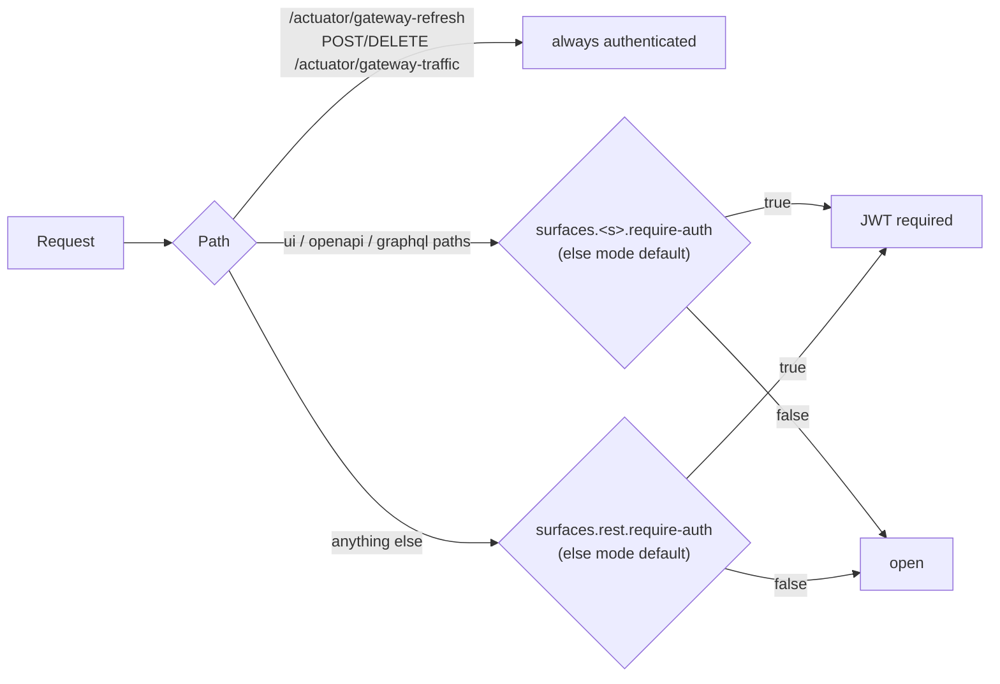

# Security Policy

## Default security posture — read this first

> This page states the posture and the model. The configuration guide — setting up the JWT
> decoder, mapping claims to scopes, TLS to backends, bringing your own chain, health probes
> under `AUTHENTICATED` — is [docs/security.md](docs/security.md).

Shiguchi boots **open at the transport layer by default**
(`shiguchi.security.mode=PERMIT_ALL`) so its try-it-now surfaces work on first run.
This is the right default for local development but **not** for an untrusted network.
Understand the following:

- In `PERMIT_ALL` mode, REST, GraphQL, Swagger UI, and GraphiQL are reachable without
  authentication. A loud WARN is logged at startup whenever this mode is active.
- Dangerous surfaces are protected **even in `PERMIT_ALL`**:
  - `POST /actuator/gateway-refresh` (schema re-discovery) always requires authentication.
  - `POST` and `DELETE /actuator/gateway-traffic/{service}` (moving calls between backend
    versions) always require authentication; reading the split does not.
  - The embedded gRPC console (`<ui-path>/**` and `/graphiql`) — whose invoke API can call
    **any** wired gRPC method with a caller-supplied payload — is gated when
    `shiguchi.ui.require-auth=true` (alias of `security.surfaces.ui.require-auth`).
    The console itself is **disabled by default** (`shiguchi.ui.enabled=false`).
- The gateway forwards request metadata (bearer tokens etc.) to backends; in `PERMIT_ALL`
  mode it does not validate it. Per-route scopes declared on proto annotations are enforced
  whenever an authenticated principal is present.

### The surface model

The default security chain groups paths into four surfaces, each individually gateable
via `shiguchi.security.surfaces.<surface>.require-auth` (null = inherit the mode):

| Surface | Paths | Typical caller |
| --- | --- | --- |
| `ui` | `<ui.path>/**`, `/graphiql` | humans in a browser |
| `openapi` | `/v3/api-docs/**`, Swagger UI | humans in a browser |
| `graphql` | `/graphql` | browser apps and services |
| `rest` | everything else — the transcoded routes | machine-to-machine |



CORS (`shiguchi.cors.*`) is processed inside the same chain and applies only to the
browser surfaces by default, so preflight succeeds on gated surfaces and machine routes
never gain permissive CORS by accident.

### Ways to secure the gateway

1. **Require auth on everything (recommended for production):**
   ```yaml
   shiguchi:
     security:
       mode: AUTHENTICATED
   spring:
     security:
       oauth2:
         resourceserver:
           jwt:
             issuer-uri: https://your-idp.example.com
   ```
   Every request then needs a valid JWT. The application **fails fast at startup** if no
   `issuer-uri`/`jwk-set-uri`/`ReactiveJwtDecoder` is configured — it will not silently
   reject every request with 401.

2. **Gate individual surfaces** — e.g. protect the browser tooling while REST stays open
   behind an authenticating ingress:
   ```yaml
   shiguchi:
     security:
       surfaces:
         ui:      { require-auth: true }
         openapi: { require-auth: true }
   ```
   Or invert it under `AUTHENTICATED`: `surfaces.rest.require-auth: false` keeps machine
   routes open for an ingress-authenticated mesh while humans still need a JWT. Any gated
   surface requires the JWT decoder configuration shown above.

3. **Bring your own chain:** define a `SecurityWebFilterChain` bean. It replaces the
   built-in configuration entirely via `@ConditionalOnMissingBean` (works in Spring Boot 3
   and 4). Use this for API keys, mTLS, or any mechanism the starter doesn't cover.

### Additional hardening

- **Terminate TLS** at the gateway or its ingress.
- **Bound GraphQL queries** — set `shiguchi.graphql.limits.max-depth` and
  `max-complexity` (both unlimited by default) on any gateway reachable by untrusted
  clients; a deeply nested or very wide query is otherwise a cheap way to make the gateway
  and its backends work hard. `spring.graphql.schema.introspection.enabled: false` hides the
  schema from anonymous callers.
- **Bound request bodies** — transcoded REST routes refuse bodies over
  `shiguchi.rest.max-request-body` (4 MB) with 413 before parsing them; GraphQL bodies
  are capped by `spring.codec.max-in-memory-size` (256 KB).
- **Security headers on the browser surfaces** are on by default
  (`shiguchi.headers.*`): a Content-Security-Policy fitted to what the bundled console,
  GraphiQL and Swagger actually load, plus `Referrer-Policy` and `Permissions-Policy`. They apply
  only to those pages, never to transcoded REST routes. Serving your own assets, or embedding the
  console elsewhere, means replacing the policy — it is a starting point, not a guarantee.
  `strict-transport-security` is off by default because an ingress usually owns it and a wrong
  `max-age` is remembered long after it is fixed.
- **Bearer tokens reach backends in plaintext unless you say otherwise.** The gateway forwards the
  caller's `Authorization` header to backends, and a service definition is `insecure: true` by
  default — so the token is readable by anything on that hop. That is fine inside a mesh with its
  own mTLS, and a credential leak anywhere else. The gateway logs a WARN at startup naming the
  services concerned; fix it with `insecure: false` (or a `tls` block) per service, or drop the
  header with your own `GrpcMetadataPopulator` bean.
- **Rate-limit callers** — `shiguchi.rate-limit.enabled: true` gives every principal (or
  client IP) a token bucket on the REST and GraphQL surfaces and answers 429 before a backend
  is called; use `backend: REDIS` when more than one gateway instance is behind the load
  balancer. Trust `client-ip-header` (`X-Forwarded-For`) only when a proxy you control sets
  it, otherwise a direct caller can choose its own bucket. → [docs/rate-limiting.md](docs/rate-limiting.md)
- **Restrict actuator exposure** — keep `management.endpoints.web.exposure.include` minimal.
- **Never commit credentials.** Inject OAuth client secrets via environment variables /
  Kubernetes secrets (see `extraEnv` in `helm/values.yaml`).

## Supported versions

This project is pre-1.0. Security fixes are applied to the latest release only.

| Version | Supported |
| --- | --- |
| latest `0.x` | ✅ |
| older | ❌ |

## Reporting a vulnerability

**Do not open a public issue for security vulnerabilities.**

Please report privately via [GitHub Security Advisories](https://github.com/appiaworks/shiguchi/security/advisories/new).

Include: affected version, a description, reproduction steps, and impact. We aim to
acknowledge reports within 5 business days and to provide a remediation timeline after
triage. Coordinated disclosure is appreciated.
