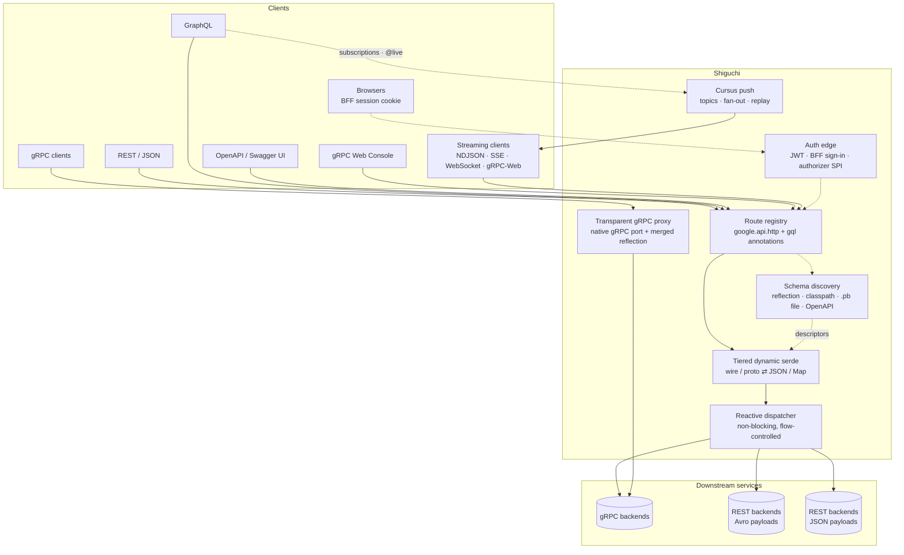
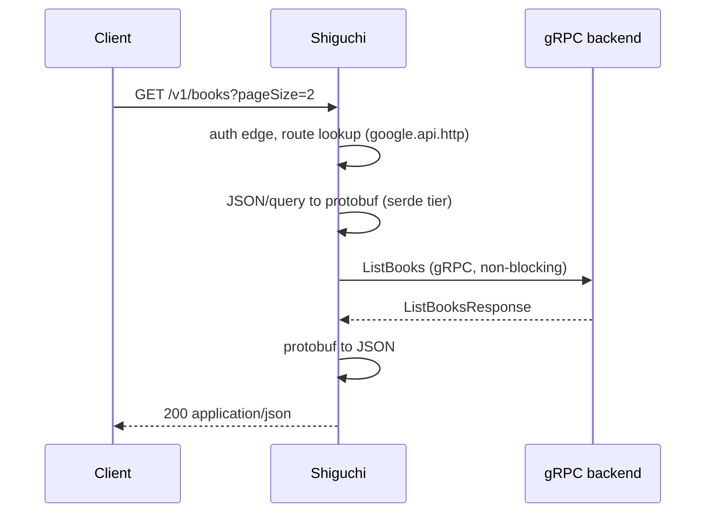

# Architecture

What sits between your clients and your gRPC services.

Streaming RPCs (server, client and bidirectional) reach REST callers as NDJSON, SSE or WebSocket frames, GraphQL callers as subscriptions or `@live` queries, and browsers as gRPC-Web.

## Request flow

How a request moves through the serde tiers: [Transcoding](transcoding.md).

The README shows the same diagrams as SVG with light and dark variants; the sources are `docs/images/architecture*.svg` and `request-flow*.svg`.
