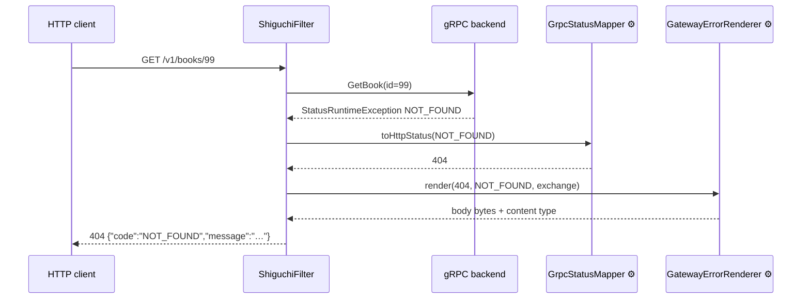

# Error handling

How a failed gRPC call becomes an HTTP error response, and how to customize both the
status mapping and the body shape.



The two ⚙ participants are Spring beans you can replace independently — status mapping
without touching the body shape, or vice versa. Scope-enforcement failures
(`AccessDeniedException`) take the same path with a synthetic `PERMISSION_DENIED` status.

## Status mapping (gRPC → HTTP)

The default mapping follows the standard transcoding convention (google.rpc.Code → HTTP,
as used by grpc-gateway and Cloud Endpoints):

| gRPC status | HTTP status |
| --- | --- |
| `OK` | 200 OK |
| `CANCELLED` | 499 Client Closed Request |
| `INVALID_ARGUMENT` | 400 Bad Request |
| `FAILED_PRECONDITION` | 400 Bad Request |
| `OUT_OF_RANGE` | 400 Bad Request |
| `UNAUTHENTICATED` | 401 Unauthorized |
| `PERMISSION_DENIED` | 403 Forbidden |
| `NOT_FOUND` | 404 Not Found |
| `ALREADY_EXISTS` | 409 Conflict |
| `ABORTED` | 409 Conflict |
| `RESOURCE_EXHAUSTED` | 429 Too Many Requests |
| `UNKNOWN` | 500 Internal Server Error |
| `INTERNAL` | 500 Internal Server Error |
| `DATA_LOSS` | 500 Internal Server Error |
| `UNIMPLEMENTED` | 501 Not Implemented |
| `UNAVAILABLE` | 503 Service Unavailable |
| `DEADLINE_EXCEEDED` | 504 Gateway Timeout |

`DEADLINE_EXCEEDED` is what a request hits when it exceeds
`shiguchi.client.default-deadline` (or the per-service `deadline`) — see
[configuration.md](configuration.md) — or the caller's own `grpc-timeout` header. A REST caller
may send `grpc-timeout` in gRPC's format (`500m`, `2S`, `1M`), as with gRPC-Web: a unary call keeps
the shorter of it and the configured deadline, a stream gets the caller's. A malformed value is
ignored; `shiguchi.rest.honor-grpc-timeout: false` ignores the header altogether.

One exception to the table: a response too big to relay is **502 Bad Gateway**, not 429. It
arrives as `RESOURCE_EXHAUSTED` too, but it means the backend answered with more than the gateway
will pass on, not that the caller should slow down. The two cases are a backend message over
`client.max-inbound-message-size` (or the service's `max-inbound-message-size`), and a response
body over `rest.max-response-body` (on any route: JSON, codecs, raw `HttpBody`, downloads, and
each message of a server stream; gRPC-Web gets the same status and `ErrorInfo` in its trailers). The body carries an `ErrorInfo` with reason
`RESPONSE_TOO_LARGE` and domain `shiguchi`, plus the `limit` and, when known, the `size`:

```json
{
  "code": "RESOURCE_EXHAUSTED",
  "message": "Response body of 5242880 bytes exceeds the limit of 1048576 bytes",
  "details": [ { "@type": "type.googleapis.com/google.rpc.ErrorInfo",
    "reason": "RESPONSE_TOO_LARGE", "domain": "shiguchi",
    "metadata": { "limit": "1048576", "size": "5242880" } } ]
}
```

A stream that goes over the cap after it has started ends with that error in-band (see
[Errors in the middle of a stream](#errors-in-the-middle-of-a-stream)).

## Default error body

```json
{ "code": "NOT_FOUND", "message": "no such user" }
```

- `code` — the gRPC status code name.
- `message` — the gRPC status description, JSON-escaped.
- `details` — present only when the backend attached error details (next section).
- Content type `application/json`.

Requests rejected by scope enforcement produce the same shape with
`code: PERMISSION_DENIED` and HTTP 403.

## Rich error details

A gRPC backend can say more than a code and a message: it can attach a
[`google.rpc.Status`](https://github.com/googleapis/googleapis/blob/master/google/rpc/status.proto)
with typed details to the call's trailers (`grpc-status-details-bin`), which is what
`StatusProto.toStatusRuntimeException` in grpc-java, `status.WithDetails` in grpc-go and
every protovalidate server interceptor do. The gateway decodes those details and passes them
through on every surface instead of dropping them:

```json
{
  "code": "INVALID_ARGUMENT",
  "message": "id must be numeric",
  "details": [
    {
      "@type": "type.googleapis.com/google.rpc.BadRequest",
      "fieldViolations": [ { "field": "id", "description": "must be numeric" } ]
    },
    {
      "@type": "type.googleapis.com/google.rpc.ErrorInfo",
      "reason": "MALFORMED_ID", "domain": "store.example.com", "metadata": { "hint": "digits only" }
    },
    { "@type": "type.googleapis.com/google.rpc.RetryInfo", "retryDelay": "2.500s" }
  ]
}
```

- Each detail is printed as proto3 JSON with its `@type`, in the order the backend attached
  them. The standard `google.rpc` types (`BadRequest`, `ErrorInfo`, `RetryInfo`, `DebugInfo`,
  `QuotaFailure`, `PreconditionFailure`, `RequestInfo`, `ResourceInfo`, `Help`,
  `LocalizedMessage`) always print. A backend's own message type prints too when the gateway
  discovered it (it is in that service's schema); a type the gateway does not know degrades to
  `{"@type": "...", "value": "<base64>"}` rather than being dropped.
- A `google.rpc.RetryInfo` also sets the `Retry-After` response header (whole seconds,
  rounded up), so a client library that honours the header backs off without parsing the body.
- On **GraphQL**, a failed field is one error whose `message` is the backend's description and
  whose `extensions` carry `grpcCode` (the `io.grpc.Status.Code` name), `errorType` (the
  DGS/Apollo classification derived from it — `BAD_REQUEST`, `NOT_FOUND`,
  `PERMISSION_DENIED`, `UNAUTHENTICATED`, `FAILED_PRECONDITION`, `UNAVAILABLE`,
  `INTERNAL`, `UNKNOWN` — so clients that already switch on `errorType` keep working),
  `service`, `method`, and `details` in the same JSON shape as above:

  ```json
  { "errors": [ { "message": "id must be numeric", "path": ["item"],
      "extensions": { "errorType": "BAD_REQUEST", "grpcCode": "INVALID_ARGUMENT",
                      "service": "errs.Store", "method": "GetItem",
                      "details": [ { "@type": "type.googleapis.com/google.rpc.BadRequest", "..." : "..." } ] } } ],
    "data": { "item": null } }
  ```

- The **web console** shows the details under the status line of a failed call, one block
  per detail, and its streaming view shows them when a stream fails part-way.
- Gateway-side rejections (scope enforcement, an unparseable request body, an invalid merge
  cursor) carry no details.

### Errors in the middle of a stream

A server-streaming route answers `200` NDJSON as soon as the first item arrives, so a backend
failure after that cannot change the HTTP status. The gateway ends the stream with one last
line instead, the way grpc-gateway does:

```
{"id":"0"}
{"id":"1"}
{"error":{"code":"UNAVAILABLE","message":"stream broke","details":[{"@type":"type.googleapis.com/google.rpc.RetryInfo","retryDelay":"0.100s"}]}}
```

The object under `error` is exactly what a unary failure would have returned as its body
(through your `GatewayErrorRenderer` if it renders JSON; the default shape otherwise). A
failure *before* the first item is still a plain HTTP error with the mapped status, the
details, and `Retry-After`.

A stream requested as Server-Sent Events (`Accept: text/event-stream`) ends with an event named
`error` whose data is that same body, so an `EventSource` listener for `error` events can tell it
apart from a message:

```
data: {"id":"0"}

event: error
data: {"code":"UNAVAILABLE","message":"stream broke","details":[...]}

```

### Reading the details from a custom renderer

`GatewayErrorRenderer.render(HttpStatus, Status, GatewayErrorDetails, ServerWebExchange)` is
what the gateway calls; `GatewayErrorDetails` offers the details typed
(`badRequest()`, `errorInfo()`, `retryInfo()`, `find(Class)`), as proto3 JSON maps
(`asJson()`), and raw (`raw()`). A renderer that only implements the three-argument form
still works and just does not see them.

## Customizing

Both halves are Spring beans the gateway backs away from when you define your own.

**Change the status mapping** — define a `GrpcStatusMapper` bean:

```java
@Bean
GrpcStatusMapper statusMapper() {
    return status -> switch (status.getCode()) {
        case NOT_FOUND -> HttpStatus.GONE;          // your convention
        default -> new DefaultGrpcStatusMapper().toHttpStatus(status);
    };
}
```

**Change the body shape** — define a `GatewayErrorRenderer` bean. The exchange gives you
access to request path, headers, and trace IDs for corporate error schemas or RFC 9457
problem details, and the details let you surface field violations the way your schema wants
them. For RFC 9457, build Spring's `org.springframework.http.ProblemDetail` rather than a map:

```java
@Bean
GatewayErrorRenderer problemJsonRenderer(ObjectMapper mapper) {
    return new GatewayErrorRenderer() {
        @Override
        public byte[] render(HttpStatus http, Status grpc, ServerWebExchange exchange) {
            return render(http, grpc, GatewayErrorDetails.none(), exchange);
        }

        @Override
        public byte[] render(HttpStatus http, Status grpc, GatewayErrorDetails details,
                             ServerWebExchange exchange) {
            ProblemDetail problem = ProblemDetail.forStatusAndDetail(http, String.valueOf(grpc.getDescription()));
            problem.setType(URI.create("https://errors.example.com/" + grpc.getCode().name()));
            problem.setTitle(grpc.getCode().name());
            problem.setInstance(URI.create(exchange.getRequest().getPath().value()));
            problem.setProperty("requestId", exchange.getRequest().getHeaders().getFirst("X-Request-Id"));
            details.badRequest().ifPresent(bad -> problem.setProperty("errors",
                    bad.getFieldViolationsList().stream()
                            .map(v -> Map.of("field", v.getField(), "message", v.getDescription()))
                            .toList()));
            try {
                return mapper.writeValueAsBytes(problem);
            } catch (JsonProcessingException e) {
                throw new UncheckedIOException(e);
            }
        }

        @Override
        public MediaType contentType() {
            return MediaType.APPLICATION_PROBLEM_JSON;
        }
    };
}
```

Inject the mapper Spring Boot auto-configures rather than creating one: Boot registers
Spring's `ProblemDetailJacksonMixin` on it, which writes `setProperty` entries (`requestId`,
`errors`) as top-level members as RFC 9457 requires. A plain `new ObjectMapper()` lacks the
mixin and nests them under `"properties"`.

The sample is for Spring Boot 3 (Jackson 2). On Spring Boot 4 the auto-configured mapper is
Jackson 3's `tools.jackson.databind.json.JsonMapper`, which also carries the mixin. Inject
that instead, and drop the `try`/`catch`: Jackson 3 throws the unchecked `JacksonException`.

```java
@Bean
GatewayErrorRenderer problemJsonRenderer(JsonMapper mapper) {
    // ... same as above, ending with:
    //     return mapper.writeValueAsBytes(problem);
}
```

No standard protobuf message models RFC 9457. The proto-native equivalent is
`google.rpc.Status` with a `google.rpc.ErrorInfo` detail, which the default body already
passes through (see [Rich error details](#rich-error-details)).

## Validation errors

With `shiguchi.validation.gateway-enabled: true`, protovalidate violations are raised
as `INVALID_ARGUMENT` before the backend is called and flow through the same mapping —
HTTP 400 with the violation summary in `message` and a `google.rpc.BadRequest` in
`details`, one `fieldViolations` entry per violation (`field` is the dotted path, `reason`
the protovalidate rule id such as `string.min_len`). The embedded gRPC server
(`shiguchi.validation.server-enabled`) sends the same `BadRequest` in its trailers. Setup,
schema modes and custom hooks are in [validation.md](validation.md).

With `shiguchi.rest.request-validation.reject-unknown-query-parameters: true`, a query
parameter that matches no request field is rejected the same way, one step earlier — before the
body is read: HTTP 400 `INVALID_ARGUMENT`, one `fieldViolations` entry per parameter with the
parameter name as `field` and `UNKNOWN_QUERY_PARAMETER` as `reason`. See
[http-annotations.md](http-annotations.md#unknown-query-parameters). With
`reject-conflicting-values: true`, a path variable or query parameter that contradicts the body
gets the same treatment with reason `BINDING_CONFLICT`
([conflicting values](http-annotations.md#conflicting-values)).
