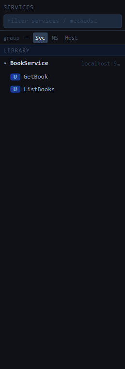
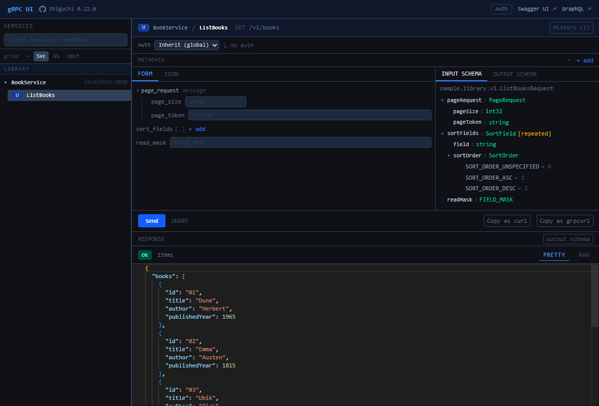
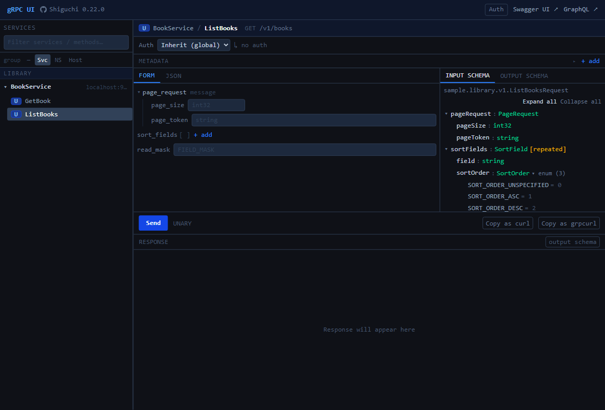
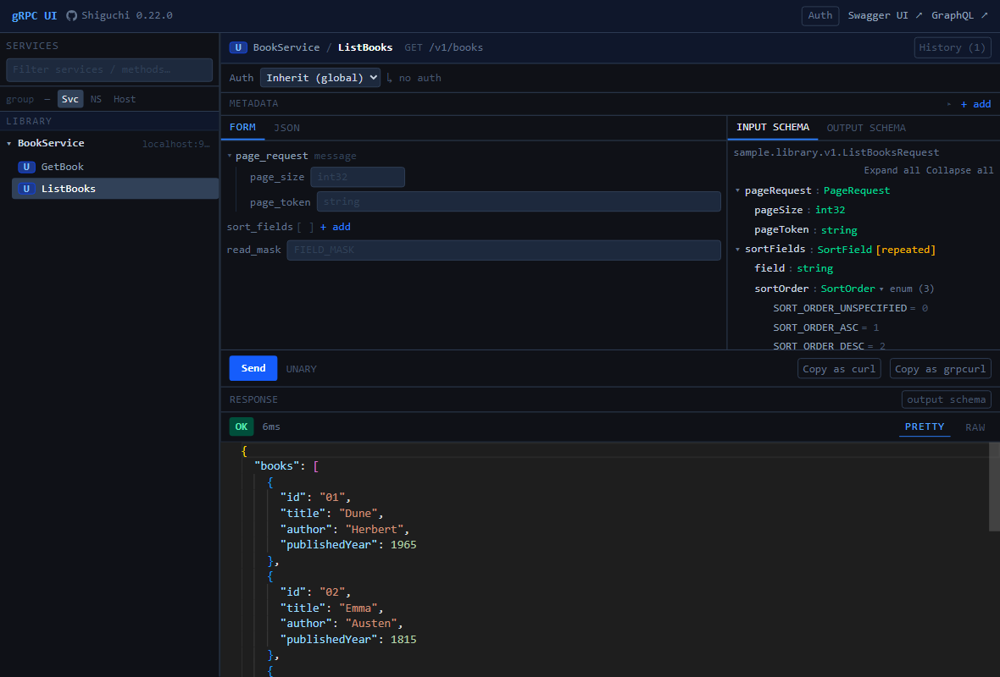
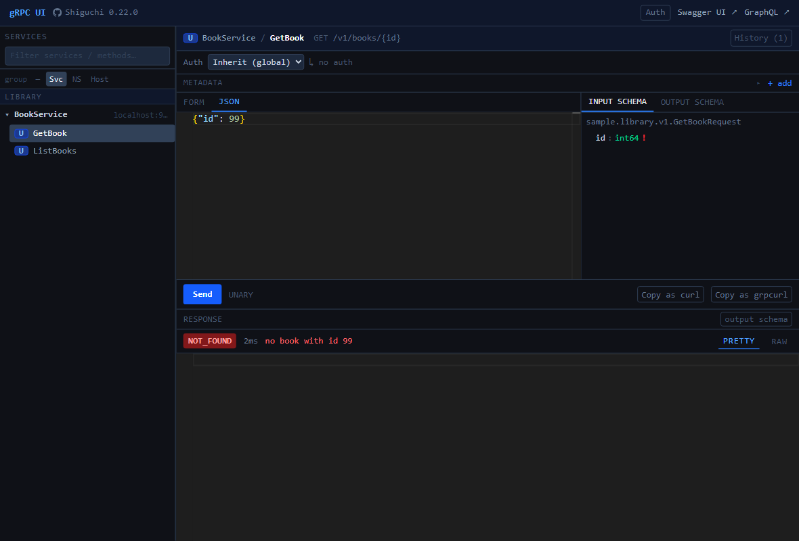
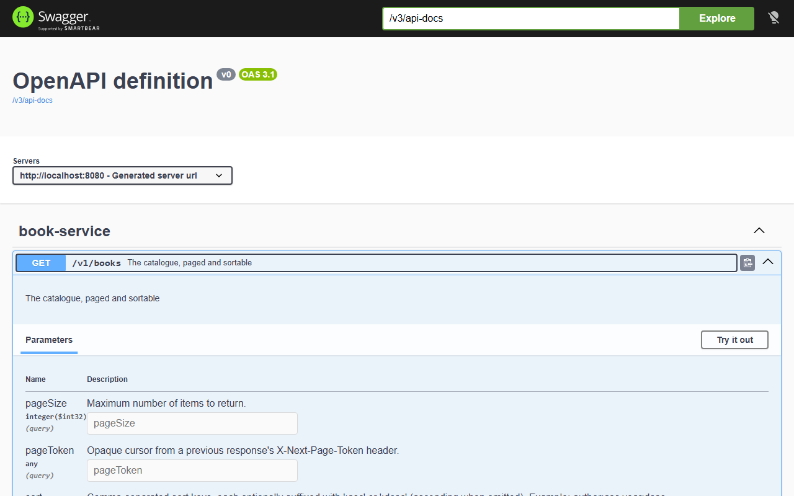
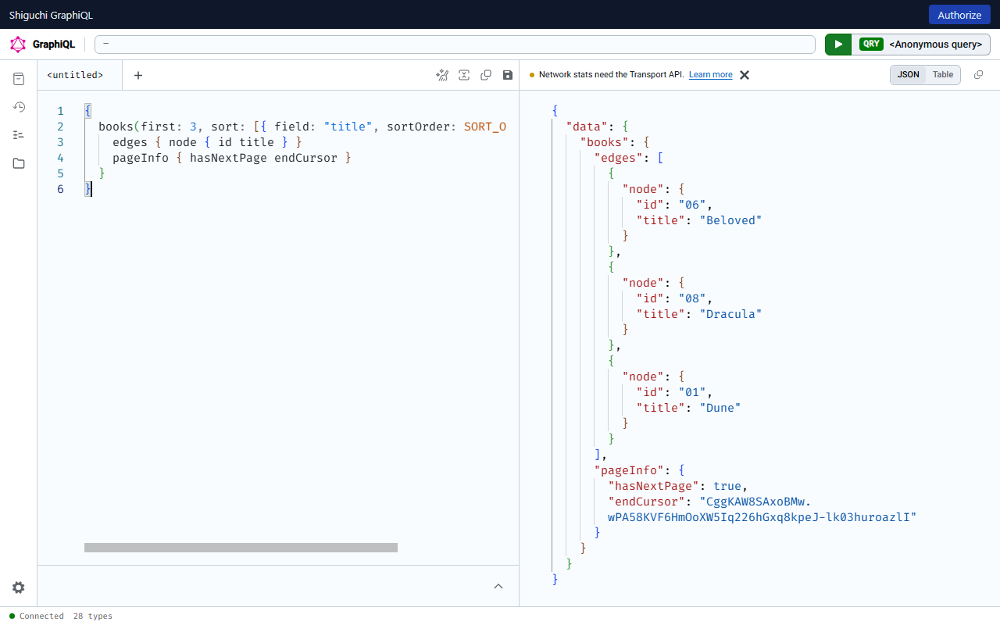

# gRPC web console (`/grpc-ui`)

The embedded try-it console for every gRPC method the gateway has discovered — no protoc,
no grpcurl, no client code. Ships with the `shiguchi-ui-*-starter` modules and mounts at
`shiguchi.ui.path` (default `/grpc-ui`).

> [!WARNING]
> The console can invoke **any** wired method. It is disabled by default
> (`shiguchi.ui.enabled=false`); enable it only inside a trusted network or behind
> auth (`shiguchi.ui.require-auth=true` or `security.surfaces.ui.require-auth=true`,
> both need an OAuth2 JWT resource server). See [../SECURITY.md](../../SECURITY.md).

## Service tree



- Every discovered backend appears with its services and methods; the badge marks the
  call type (`U` unary, streaming types accordingly).
- A **client-streaming** method shows a message list under the request editor: the editor holds
  the first message, **+ message** adds the ones after it, and invoking sends them all on one
  call and shows the backend's single response.
- **Filter** box narrows services/methods as you type.
- **group** toggles regroup the tree: flat (`—`), by service (`Svc`), by proto namespace
  (`NS`), or by backend host (`Host`) — useful when the gateway fronts many backends.
- The header shows the pass-through proxy port when `shiguchi.grpc.enabled=true` and
  links to the other surfaces (Swagger UI, GraphiQL).

## Invoking a method

Selecting a method opens the invoke view:



### The request



Working top to bottom:

- **Binding header** — call type, `Service / Method`, and the HTTP binding derived from
  the proto's `google.api.http` annotation (`GET /v1/books/{id}` here). **History** keeps
  recent calls per method for one-click replay.
- **Auth** — inherit the global session token (set once via the header **Auth** button)
  or paste a per-call bearer token. The active choice is echoed next to the selector
  (`↳ no auth` above).
- **Metadata** — `+ add` attaches arbitrary gRPC metadata to the call, e.g.

  | key | value |
  | --- | --- |
  | `x-tenant-id` | `acme` |
  | `x-request-id` | `req-42` |

- **Request** — the **Form** tab (the default) for field-by-field input, or the **JSON** tab for
  the proto3 JSON of the input message (schema-aware editor). The console remembers the last tab you used
  and keeps both in sync; switching to the form with invalid JSON shows the parse error instead. Client-streaming
  calls take message #1 in the form, further messages as JSON, with a *copy of #1* button. The form uses pickers for
  `Timestamp` (date-time), `google.type.Date` (date) and `google.type.TimeOfDay` (time) fields,
  which travel as the ISO text described in [json-types.md](json-types.md). For `GetBook`
  (`demo.library.GetBookRequest`) the request is simply:

  ```json
  {"id": 1}
  ```

  The schema panel on the right shows the request message structure with field types
  (`id : int64`), so you never need the `.proto` file open. Its **OUTPUT SCHEMA** tab shows the response message the same way. Note the proto3 JSON rules:
  int64 accepts a number or a string, field names accept camelCase or snake_case.

### The response

**Send** invokes through the gateway's dynamic dispatch — the same serde and metadata
path REST requests take. A successful call shows the gRPC status, server latency, and
the decoded response message as pretty or raw JSON:



```json
{
  "id": "1",
  "title": "The Pragmatic Programmer",
  "author": "Hunt & Thomas",
  "year": 1999
}
```

(`id` is a string in JSON because proto3 maps int64 → JSON string.)

### Errors

gRPC failures render with the status code, latency, and the server's status description —
here `GetBook` with `{"id": 99}`:



The same call through the REST surface would map to HTTP 404 with the gateway's error
body (`{"code":"NOT_FOUND","message":"no book with id 99"}`) — see
[error-handling.md](error-handling.md) for the full mapping.

When the backend attaches `google.rpc.Status` details to the failure (a `BadRequest` with
field violations, an `ErrorInfo`, a `RetryInfo`, one of its own message types), the console
lists them under the status line, one block per detail headed by its type. A streaming call
that fails part-way keeps the chunks received so far and shows the failure the same way.

### Client streams from a file

On a client-streaming method, **from file…** in the message-stream header replaces the messages
with those of a file: NDJSON / JSON Lines (one JSON object per line) or a JSON array. The first
message fills the request editor and the rest become the extra messages. A malformed file is
rejected with the offending line and nothing is replaced. The whole file is read into the browser,
so keep it to what the page can comfortably list.

### Long server streams

A server-streaming call keeps only the last **1000** messages in the response pane, so a stream
that runs for hours cannot exhaust the browser's memory. The header shows "last 1000 of 25000
chunks" once older messages have been dropped. Change the number with the **keep last** field next
to the Stream button (`0` keeps everything); it is remembered per browser.

To keep every message, tick **save to file** before pressing Stream: the console asks for a file and
writes each message to it as it arrives, one compact JSON object per line (NDJSON), while the pane
still shows the most recent ones. The option needs the File System Access API (Chromium-based
browsers) and is hidden elsewhere.

## The other browser surfaces

The console links to the gateway's sibling surfaces for the same services:

**OpenAPI / Swagger UI** (`/swagger-ui.html`, from `shiguchi-openapi-*-starter`) — every
`google.api.http` binding becomes an OpenAPI 3 operation with schemas generated from the
proto messages:



**GraphQL / GraphiQL** (`/graphiql`, from `shiguchi-graphql-*-starter`) — methods become
queries/mutations (from `(shiguchi.graphql)` annotations, or convention-named like
`libraryListBooks` when unannotated). With the console enabled (`shiguchi.ui.enabled=true`) `/graphiql`
opens the gateway's own page, built into the console bundle (no CDN), with an **Authorize** button that
offers the same sign-in methods as the console: a manual bearer token, an API key, OAuth2 authorization
code with PKCE, and client credentials, driven by `shiguchi.openapi.security-schemes`. The token stays
in memory (a reload signs out) and is sent as `Authorization` or the scheme's API-key header on every
query. When `spring.graphql.websocket.path` is set, subscriptions run over `graphql-transport-ws` on the same
origin and the credential is sent in the `connection_init` payload (a browser cannot set WebSocket headers), so
the gateway reads a `{"Authorization": "Bearer <jwt>"}` payload and authenticates the socket with the same JWT decoder and converter as
the HTTP chain (a rejected token closes the connection; API keys are not read from the payload). Without the console, Spring GraphQL's stock page is served instead, without sign-in:



## Push

With the push surface on ([push.md](cursus/index.md)), a **Push** button in the top bar switches the
console to its admin views: the instance overview and namespaces, the topics with a live tail,
the open connections with disconnect, and a test publish. They read the `gateway-push` actuator
endpoint, so it must be exposed; the writes carry the console's global auth token.

## Configuration

| Property | Default | Meaning |
| --- | --- | --- |
| `shiguchi.ui.enabled` | `false` | Mount the console |
| `shiguchi.ui.path` | `/grpc-ui` | Base path |
| `shiguchi.ui.require-auth` | `false` | Require an authenticated principal for the whole UI surface (alias of `security.surfaces.ui.require-auth`) |

The console's static assets are served under `shiguchi.ui.path` too, so a custom path works.

### Servlet (Spring MVC) applications

The console comes in two starters; pick the one that matches the application's web stack:

| Starter | Web stack | Brings |
| --- | --- | --- |
| `shiguchi-ui-spring-boot4-starter` | Reactive (WebFlux) | `spring-boot-starter-webflux` |
| `shiguchi-ui-webmvc-spring-boot4-starter` | Servlet (Spring MVC) | `spring-boot-starter-web` |

```kotlin
implementation("io.github.appiaworks:shiguchi-ui-webmvc-spring-boot4-starter:<version>")
```

The WebMVC starter embeds the console in an existing Spring MVC application, next to its own
controllers, with no WebFlux or Netty on the classpath. It serves the same console with the same
routes (`{path}/api/config`, `/api/schema`, `/api/invoke`, `/api/invoke/stream`,
`/api/auth/{scheme}/token`) and calls the configured gRPC services directly. The principal
(`x-principal`), the `Authorization` header and the `shiguchi.client.forward-headers` /
tracing headers reach the backend as they do on the gateway.

Servlet mode is the console only. These gateway features are reactive and are not started:

- REST transcoding, `REST_DOWNSTREAM` services and HTTP merge sources
- gRPC-Web, rate limiting, the access log and the security headers filter
- the gateway's security posture (`shiguchi.security.*`): `shiguchi.ui.require-auth` is not
  applied, and the host application's own `SecurityFilterChain` protects `{path}/**`
- the BFF relay, the `UpstreamCredentialSource` hook, and Cursus (push)

The gateway's actuator endpoints still register when Actuator is on the classpath.

Spring Security comes with the console, so without a `SecurityFilterChain` of its own the
application gets Boot's default chain: HTTP Basic with a generated password, and CSRF on POST.
Declare a chain that covers `{path}/**`. With CSRF on, keep the token in a cookie the console
can read and accept it raw from the header:

```java
http.csrf(csrf -> csrf
        .csrfTokenRepository(CookieCsrfTokenRepository.withHttpOnlyFalse())
        .csrfTokenRequestHandler(new CsrfTokenRequestAttributeHandler()));
```

The console sends the `XSRF-TOKEN` cookie back as `X-XSRF-TOKEN` on its POSTs. Spring Security
loads the token lazily, so the cookie is only written once something reads it: add a filter that
reads the request's `CsrfToken`, as `samples/sample-grpc-ui-servlet` does.

An anonymous caller reaches the backend as `x-principal: anonymous`, as on the gateway. The
console resolves its API and assets relative to its own page, so it works under a
`server.servlet.context-path`.

See `samples/sample-grpc-ui-servlet`.

The console works with every discovery mode (`DYNAMIC` reflection, `STATIC` classpath
stubs, `PB_FILE`). Method visibility respects `services[].include-methods` /
`exclude-methods` filters.

To embed the console in the gRPC server application itself, point a `STATIC` service at the
application's own server and let it find the `BindableService` beans:

```yaml
shiguchi:
  services:
    - name: self
      host: localhost
      port: 9090                 # this application's gRPC server port
      mode: STATIC
      auto-discover:
        spring-beans: true       # the application's BindableService beans
  ui:
    enabled: true
```

> Reference: [Console reference](../reference/console.md) lists the routes and JSON shapes; the [OpenAPI reference](../reference/openapi.md) lists the full mapping rules, keys and defaults.
