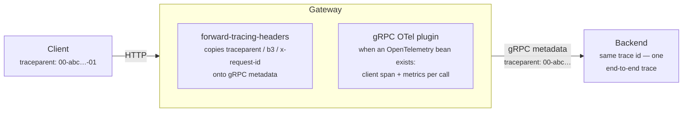

# Observability

What the gateway exposes for metrics, tracing, and logging, and how to turn each on.

## Metrics (Micrometer)

Every outbound channel carries a Micrometer interceptor. With any Micrometer registry on
the classpath (e.g. `micrometer-registry-prometheus` + actuator) you get:

| Metric | Type | Tags |
| --- | --- | --- |
| `grpc.client.call.started` | counter | `grpc_service`, `grpc_method` |
| `grpc.client.call.duration` | timer | `grpc_service`, `grpc_method`, `grpc_status` |
| `grpc.client.call.messages.sent` | counter | `grpc_service`, `grpc_method` |
| `grpc.client.call.messages.received` | counter | `grpc_service`, `grpc_method` |
| `gateway.ratelimit.requests` | counter | `outcome` = `allowed` / `rejected` (inbound [rate limiter](rate-limiting.md), when enabled) |
| `gateway.bff.refresh` | counter | `outcome` = `ok` (this instance refreshed a session's token) / `rejected` (the issuer refused, the session ended) / `transient` (the issuer or the store could not be reached) / `waited` (another request or instance had refreshed it); browser sessions, [design/bff.md](design/bff.md#8-token-refresh-built-in-g2), when `shiguchi.bff.enabled` |
| `gateway.bff.revocation` | counter | `outcome` = `revoked` (the issuer accepted the revocation of a logged-out session's token) / `failed` (non-2xx, timeout or connection error) / `skipped` (the provider has no revocation endpoint); best effort, never changes the logout, when `shiguchi.bff.enabled` |
| `gateway.bff.logout` | counter | `kind` = `backchannel` (an issuer's logout token) / `admin` (`BffSessions` or the `gateway-bff-sessions` endpoint) / `user` (the browser's own logout) / `refresh-rejected` (the issuer refused the refresh token); counts sessions ended, [design/bff.md](design/bff.md#10-session-lifecycle-built-in-g5), when `shiguchi.bff.enabled` |

`grpc_status` is the gRPC code name (`OK`, `NOT_FOUND`, …), so error rate slices need no
message parsing. Suggested panels:

- rate of started calls by service/method (counter rate)
- p50/p95/p99 latency by service/method (timer percentiles)
- error rate by status code (duration counter filtered `grpc_status != OK`)
- messages per call by method (`messages.received` rate ÷ `started` rate) — 1 for a unary
  call, the stream length for a server-streaming one

The message counters are what make streaming visible: a server-streaming call that returns ten
thousand items is still one `started` and one `duration` sample. They count the messages of the
logical call — gRPC retries happen below the interceptor, so a retried request is still one
message sent. Tag values come from the loaded descriptors, never from caller input, so the
number of series is bounded by your protos.

Standard Spring Boot HTTP server metrics (`http.server.requests`) cover the inbound side,
tagged with route path and HTTP status.

The GraphQL surface adds DGS's metrics (`gql.query` per operation, `gql.resolver` per data
fetcher, `gql.error`) and Spring GraphQL's `graphql.request` and `graphql.datafetcher`
observations. The two per-field ones run once for every field a query completes, which is
≈15–20% of a GraphQL request's time on a list of a hundred objects
([benchmarks](../shiguchi-benchmarks/README.md#graphql-over-http-µsrequest-jdk-25-windows-11-loopback-2026-10-07)). They stay on by default: the
gateway's resolvers are its gRPC calls, and a per-resolver timer is how a slow one is found. A
deployment that watches request latency only can turn them off and keep the rest:

```yaml
management:
  metrics:
    dgs-graphql:
      instrumentation:
        enabled: false   # gql.resolver
  observations:
    enable:
      graphql:
        datafetcher: false   # graphql.datafetcher
```

### Gateway state

The call metrics above describe traffic. These describe the gateway itself — what it loaded,
what it is serving, and whether that is changing:

| Metric | Type | Tags |
| --- | --- | --- |
| `gateway.services.configured` | gauge | — |
| `gateway.services.loaded` | gauge | — |
| `gateway.routes` | gauge | — |
| `gateway.services.loads` | counter | `service`, `phase` = `initial` / `reload` / `startup` / `ready-retry` / `retry` / `refresh`, `outcome` = `loaded` / `failed` |
| `gateway.discovery.instances` | gauge | `service` (the discovery service id) |
| `gateway.descriptor.cache.lookups` | counter | — |
| `gateway.descriptor.cache.misses` | counter | — |

The gauges read live state, so a [refresh](configuration.md) that changes the route count shows
up at the next scrape. Things worth alerting on:

- `gateway.services.loaded < gateway.services.configured` for longer than your retry window —
  a backend is not coming back. The health indicator says the same thing; this one graphs it.
- a sustained rate on `gateway.services.loads{outcome="failed"}` — a backend is failing to
  reload while the gateway keeps serving its last-known routes. Nothing else reports this: the
  health check is `UP` the whole time, because the routes are still there.
- `gateway.routes` dropping after a refresh — the backend's schema shrank, and calls that used
  to work now 404.
- `gateway.discovery.instances{service="…"} == 0` — the registry has no instances left for a
  [discovery](service-discovery.md) backend.
- `gateway.descriptor.cache.misses / gateway.descriptor.cache.lookups` — the miss rate should
  fall to near zero once traffic is warm. A miss rate that stays high means descriptors are
  being rebuilt per call.

The load counter separates `initial` from `reload` on purpose: a backend that reports `reload`
every few seconds is a refresh loop, which looks identical to a healthy gateway on every other
signal.

### Prometheus

Three things on the gateway: the registry, the endpoint, and histogram buckets for the timers.

```kotlin
runtimeOnly("io.micrometer:micrometer-registry-prometheus")
implementation("org.springframework.boot:spring-boot-starter-actuator")
```

```yaml
management:
  endpoints:
    web:
      exposure:
        include: health,prometheus
  metrics:
    distribution:
      percentiles-histogram:
        grpc.client.call.duration: true    # p50/p95/p99 of backend calls
        http.server.requests: true         # the same for end-to-end requests
```

The third block is the one people forget. A Micrometer timer exports only `_count`, `_sum`
and `_max` by default; `histogram_quantile()` needs `_bucket` series, and only the
`percentiles-histogram` setting produces them. Without it a latency panel is empty and nothing
says why.

This is what `sample-discovery-gateway` exposes on `/actuator/prometheus` after a burst of
`GET /v1/products`, fifteen requests for a product that does not exist, and one instance of
its three-instance backend stopped (bucket lines trimmed to a few):

```
# TYPE gateway_services_configured gauge
gateway_services_configured 1.0
# TYPE gateway_services_loaded gauge
gateway_services_loaded 1.0
# TYPE gateway_routes gauge
gateway_routes 2.0
# TYPE gateway_discovery_instances gauge
gateway_discovery_instances{service="catalog-service"} 2.0
# TYPE gateway_services_loads_total counter
gateway_services_loads_total{outcome="loaded",phase="initial",service="catalog"} 1.0
# TYPE grpc_client_call_started_total counter
grpc_client_call_started_total{grpc_method="GetProduct",grpc_service="sample.catalog.CatalogService"} 15.0
grpc_client_call_started_total{grpc_method="ListProducts",grpc_service="sample.catalog.CatalogService"} 160.0
# TYPE grpc_client_call_duration_seconds histogram
grpc_client_call_duration_seconds_count{grpc_method="GetProduct",grpc_service="sample.catalog.CatalogService",grpc_status="NOT_FOUND"} 15
grpc_client_call_duration_seconds_sum{grpc_method="GetProduct",grpc_service="sample.catalog.CatalogService",grpc_status="NOT_FOUND"} 0.0213274
grpc_client_call_duration_seconds_count{grpc_method="ListProducts",grpc_service="sample.catalog.CatalogService",grpc_status="OK"} 160
grpc_client_call_duration_seconds_sum{grpc_method="ListProducts",grpc_service="sample.catalog.CatalogService",grpc_status="OK"} 0.300221
grpc_client_call_duration_seconds_bucket{grpc_method="ListProducts",grpc_service="sample.catalog.CatalogService",grpc_status="OK",le="0.001"} 0
grpc_client_call_duration_seconds_bucket{grpc_method="ListProducts",grpc_service="sample.catalog.CatalogService",grpc_status="OK",le="0.006990506"} 160
grpc_client_call_duration_seconds_bucket{grpc_method="ListProducts",grpc_service="sample.catalog.CatalogService",grpc_status="OK",le="+Inf"} 160
# TYPE grpc_client_call_duration_seconds_max gauge
grpc_client_call_duration_seconds_max{grpc_method="ListProducts",grpc_service="sample.catalog.CatalogService",grpc_status="OK"} 0.0065257
```

Micrometer renames on the way out: dots become underscores, a counter gains `_total`, a timer
becomes `_seconds` with the histogram suffixes. The NOT_FOUND calls are a separate series
because `grpc_status` is a tag, which is what makes error rates a label filter rather than a
regex over messages.

Scrape it like any Boot application:

```yaml
scrape_configs:
  - job_name: shiguchi
    metrics_path: /actuator/prometheus
    static_configs:
      - targets: ["gateway:8080"]
```

The queries behind the panels, in the order you tend to need them:

| Question | PromQL |
| --- | --- |
| Calls per second, by method | `sum by (grpc_service, grpc_method) (rate(grpc_client_call_started_total[$__rate_interval]))` |
| Failed calls, by status | `sum by (grpc_status) (rate(grpc_client_call_duration_seconds_count{grpc_status!="OK"}[$__rate_interval]))` |
| Error ratio | `sum(rate(grpc_client_call_duration_seconds_count{grpc_status!="OK"}[5m])) / sum(rate(grpc_client_call_duration_seconds_count[5m]))` |
| Messages per call (stream length), by method | `sum by (grpc_service, grpc_method) (rate(grpc_client_call_messages_received_total[$__rate_interval])) / sum by (grpc_service, grpc_method) (rate(grpc_client_call_started_total[$__rate_interval]))` |
| p95 backend latency | `histogram_quantile(0.95, sum by (le) (rate(grpc_client_call_duration_seconds_bucket[$__rate_interval])))` |
| p95 per method | `histogram_quantile(0.95, sum by (le, grpc_method) (rate(grpc_client_call_duration_seconds_bucket[$__rate_interval])))` |
| p95 end to end (gateway included) | `histogram_quantile(0.95, sum by (le) (rate(http_server_requests_seconds_bucket{uri!~"/actuator.*"}[$__rate_interval])))` |
| Responses by HTTP status | `sum by (status) (rate(http_server_requests_seconds_count{uri!~"/actuator.*"}[$__rate_interval]))` |
| A backend is missing | `gateway_services_loaded < gateway_services_configured` |
| Reloads failing | `increase(gateway_services_loads_total{outcome="failed"}[5m]) > 0` |
| Discovery ran dry | `gateway_discovery_instances == 0` |
| Rate limiter rejecting | `sum by (outcome) (rate(gateway_ratelimit_requests_total[$__rate_interval]))` |

One limit of the inbound metric: transcoded routes are served by a filter, not a Spring
handler, so `http_server_requests` tags them `uri="UNKNOWN"` (and a 404 as `uri="NOT_FOUND"`).
Per-route breakdowns therefore come from the `grpc_method` tag on the outbound metrics, or from
the [access log](#access-log); `http_server_requests` is for the status and end-to-end latency
of the whole surface.

### Grafana dashboard

[`docs/grafana/shiguchi.json`](grafana/shiguchi.json) is a dashboard over
exactly these metrics, in five rows:

- **Gateway state** — backends loaded against configured, route count, discovery instances,
  descriptor cache miss ratio, and the load counter by outcome and by phase.
- **Traffic to backends** — calls per second by method, failed calls by gRPC status, error
  ratio with thresholds at 1 % and 5 %.
- **Streams** — messages received and sent per second by method, and messages per call (1 for
  unary calls, the average stream length for streaming ones), which is where a stream that
  suddenly runs longer or shorter shows first.
- **Latency** — p50/p95/p99 of backend calls, and p95 per method so one slow RPC does not hide
  behind the aggregate.
- **Inbound HTTP** — responses by status, end-to-end percentiles, rate-limiter decisions.

It selects on `job`, `instance` and `grpc_service`, so one copy serves every gateway a
Prometheus scrapes. Import it through *Dashboards → New → Import*, or provision it from the
file. The fastest way to see it with data is
[`samples/observability`](../samples/observability): a `docker compose up` brings Prometheus
and Grafana, provisioned with this dashboard, scraping whichever sample is running on the host,
and a `load.sh` keeps that sample busy.

The latency rows need the `percentiles-histogram` setting above on the gateway they watch;
each of those panels says so in place of data when it is missing.

## Tracing (OpenTelemetry)



Two independent layers keep traces intact:

When an `OpenTelemetry` bean is present in the context (e.g. via the OpenTelemetry Spring
Boot starter or Boot's OTLP support), the gateway automatically installs gRPC's native
OTel plugin on every outbound channel. That gives you:

- W3C `traceparent` / `tracestate` propagation from the inbound HTTP request through to
  the gRPC backend — end-to-end traces across the gateway with no configuration;
- gRPC client call metrics in OTel format.

Configure exporter and sampling through the standard Boot properties
(`management.otlp.*`, `management.tracing.*`). No `shiguchi.*` property is involved —
presence of the `OpenTelemetry` bean is the switch.

Independent of the OTel SDK, `shiguchi.client.forward-tracing-headers` (default
`true`) copies the well-known tracing headers from the inbound request straight onto the
outbound gRPC metadata — `traceparent`, `tracestate`, `b3`, `x-b3-*`, `x-request-id`,
`x-amzn-trace-id`, `x-cloud-trace-context` — so traces stay intact even on gateways with
no tracing SDK installed. Proprietary correlation headers go in
`shiguchi.client.forward-headers`.

## Access log

Enterprise-style request log, one line per request on the dedicated logger
`dev.appiaworks.shiguchi.access`:

```yaml
shiguchi:
  access-log:
    enabled: true
    format: JSON   # or COMMON (default)
```

Fields: remote IP (first `X-Forwarded-For` hop when present, else the socket peer), HTTP
method, path + query, matched gRPC route (`service/method`), HTTP status, gRPC status,
duration ms, authenticated principal, user agent, `X-Request-Id`, and protocol (`rest`,
`grpc-web`, or `http` for anything else). `JSON` emits one object per line for ELK/Splunk
ingestion:

```json
{"remoteIp":"203.0.113.7","method":"GET","path":"/v1/books/1","query":"",
 "route":"demo.library.LibraryService/GetBook","status":200,"grpcStatus":"OK",
 "durationMs":8,"principal":"svc-portal","userAgent":"portal/2.3","requestId":"req-9f2c",
 "protocol":"rest"}
```

The log wraps the whole pipeline — it runs before Spring Security, rate limiting and gRPC-Web
— so the duration covers all of it. Logged:

- every transcoded REST call and every gRPC-Web call;
- any request that matched a Spring Cloud Gateway route (passthrough and your own routes);
- requests turned away before routing: `401`, `403` and `429`.

Everything else — console assets, actuator probes — is left out. `COMMON` lines end with
`proto=<protocol>`; the new field is appended so existing parsers keep matching.

Route the logger to its own file or collector through your logging backend's appender
configuration (it propagates like any other SLF4J logger).

## Request id

Every request carries an id: the caller's `X-Request-Id` when they sent one, so a trace that
started at an ingress keeps its identity, else a fresh UUID. It goes three places — the Reactor
context, SLF4J's MDC under `requestId`, and back to the caller on the response — and it is
already forwarded to backends as `x-request-id` (see `client.forward-tracing-headers`).

Print it in every line by adding it to the log pattern:

```yaml
logging:
  pattern:
    level: "%5p [%X{requestId:-}]"
```

Now an error in a gateway log and the line the caller quotes from their own failure share one id.
The access log carries it as `requestId` whether or not the caller supplied one.

On an internet-facing gateway set `shiguchi.request-id.trust-inbound: false`. The id reaches
the logs, so a caller who chooses it can make unrelated requests look alike. A caller-supplied id
is trimmed to 128 printable characters in any case.

## Logging

Outbound call logging is per-logger and off by default:

```yaml
logging.level.dev.appiaworks.shiguchi.gateway.GrpcLoggingInterceptor: DEBUG  # call start/end + status + duration
logging.level.dev.appiaworks.shiguchi.gateway.GrpcLoggingInterceptor: TRACE  # + request/response bodies as JSON
```

`DEBUG` on `dev.appiaworks.shiguchi.rest.ReactiveGrpcDispatcher` additionally logs each dispatch
with the request map (useful when diagnosing transcoding issues).

> TRACE logs full message bodies — never enable it in production with sensitive payloads.

## Health and readiness

The gateway is a standard Spring Boot app: actuator `health` works out of the box, and the
gateway adds two things to it.

### The `shiguchi` health indicator

One entry per configured service — whether its schema loaded, when, how many routes it
contributes, the state of its channel, and when it is not loaded the last error and how many
attempts there were. `UP` when every configured service is loaded, `DOWN` otherwise:

```json
{
  "status": "DOWN",
  "components": {
    "shiguchi": {
      "status": "DOWN",
      "details": {
        "configured": 2, "loaded": 1,
        "services": {
          "library": { "status": "UP", "mode": "DYNAMIC", "target": "library:9090",
                       "loadedAt": "2026-09-16T08:12:03Z", "routes": 5, "channel": "READY" },
          "orders":  { "status": "DOWN", "mode": "DYNAMIC", "target": "orders:9090",
                       "lastError": "UNAVAILABLE: io exception", "lastFailureAt": "2026-09-16T08:12:33Z",
                       "attempts": 3 }
        }
      }
    }
  }
}
```

Details need `management.endpoint.health.show-details: always` (or `when-authorized`). Turn
the indicator off with `management.health.shiguchi.enabled: false` or
`shiguchi.health.enabled: false`. It is not part of the readiness group unless you add it
(`management.endpoint.health.group.readiness.include: readinessState,shiguchi`) — readiness
is handled by the policy below instead, which needs no configuration.

### Readiness follows the backends

A backend that cannot be reached when the gateway starts does not stop the gateway: its routes
are simply missing. Before, that was invisible to Kubernetes — the pod reported ready and
answered 404 for every route of the missing backend. Now `shiguchi.health.readiness`
decides what Spring Boot's readiness state (what `/actuator/health/readiness` and the Helm
chart's readiness probe read) says:

| Policy | Ready when |
| --- | --- |
| `ALL_LOADED` (default) | every configured service has loaded |
| `ANY_LOADED` | at least one has |
| `IGNORE` | always; backends never affect readiness |

The gateway keeps retrying the missing backends every `shiguchi.startup.retry-interval`
(30 s; `0` disables the background retry) and flips to ready the moment the policy is met, so a
gateway started before its backends joins the rotation by itself. The retry rebuilds the
OpenAPI document, the GraphQL schema and the console schema when a backend loads. Set
`shiguchi.startup.fail-fast: true` to abort startup instead, with every unloaded service
and its last error in the message.

Liveness is untouched: a missing backend is a reason not to receive traffic, not a reason to
be restarted.

The `gateway-refresh` actuator endpoint (always authenticated) re-runs schema discovery on
demand and doubles as a connectivity check to the backends; a failed refresh keeps the last
good schema and shows up as `lastError` on the indicator.

## The `gateway-routes` endpoint

Health answers "is the gateway all right". This answers the question you actually have when a
call comes back 404: **did that route load, and where does it go?**

```yaml
management:
  endpoints.web.exposure.include: health,gateway-routes
```

`GET /actuator/gateway-routes` lists every configured service, whether it loaded, and the
routes it contributes:

```json
{
  "configured": 2, "loaded": 1, "routeCount": 5,
  "services": [
    {
      "name": "library", "mode": "DYNAMIC", "target": "library:9090",
      "loaded": true, "loadedAt": "2026-09-16T08:12:03Z", "channel": "READY",
      "routeCount": 5,
      "routes": [
        { "method": "library.Books/GetBook", "type": "UNARY", "transport": "GRPC",
          "http": "GET /v1/books/{id}", "idempotency": "NO_SIDE_EFFECTS" },
        { "method": "library.Books/ListBooks", "type": "UNARY", "transport": "GRPC",
          "http": "GET /v1/books", "graphql": "books", "graphqlType": "QUERY" }
      ]
    },
    {
      "name": "orders", "mode": "DYNAMIC", "target": "orders:9090",
      "loaded": false, "lastError": "UNAVAILABLE: io exception",
      "lastFailureAt": "2026-09-16T08:12:33Z", "attempts": 3,
      "routeCount": 0, "routes": []
    }
  ]
}
```

`GET /actuator/gateway-routes/{name}` returns one service, and 404s a name that is not
configured. Per route you get the gRPC method and type, the transport, the HTTP binding and
body field, the GraphQL field and operation type, and — only when the proto declared them —
the auth scopes, idempotency level, cache TTL and REST upstream.

The routes are read from the dispatcher's own registry, so what it reports is what it serves.
Common uses:

- a call 404s: check the path in `http` against the one you are calling — a `{var}` in a
  different place is the usual answer
- a call 401/403s: `scopes` shows what the proto asked for
- after a refresh: `routeCount` per service, next to `loadedAt`

It is read-only and exposes nothing a caller could not already learn from the OpenAPI document
or the GraphQL schema — but it is an actuator endpoint, so it follows whatever you have set for
actuator security, and is not exposed by default.
