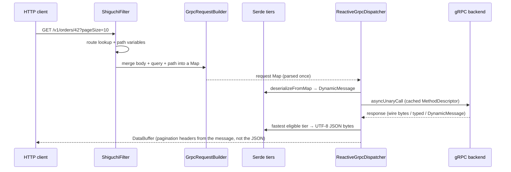
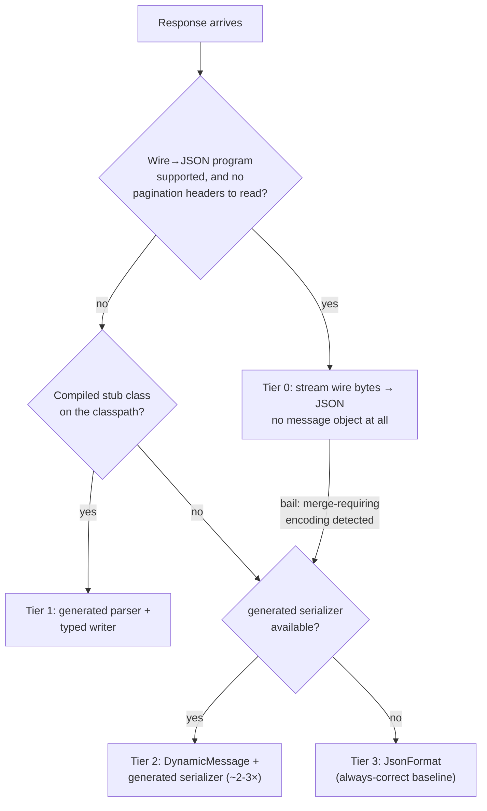

# Transcoding: how gRPC becomes REST and GraphQL

The gateway never requires code generation for the services it fronts. It discovers proto
schemas at runtime (gRPC server reflection, classpath scan, or a `.pb` descriptor file) and
transcodes between protobuf and JSON/GraphQL with a tiered serde engine that picks the
fastest correct path per message type.

## Request flow (REST)

Server-streaming responses use the same path per item, emitted as NDJSON with real flow
control: gRPC `request(n)` is driven by downstream reactive demand, so a slow consumer
backpressures the backend, and client disconnects cancel the gRPC call.

Client-streaming requests run the same path in reverse: each NDJSON line of the request body is
built into a message and sent as it arrives, gated by the call's `isReady()`, so a fast uploader
cannot outrun a slow backend or force the gateway to buffer the upload.

## The serde tiers

- **Tier 0 — `WireJsonTranscoder`.** A per-descriptor precompiled program walks the wire
  tags with `CodedInputStream` and emits JSON tokens directly: scalars, nested messages, map
  entries and every well-known type (`Timestamp`, `Duration`, the wrappers, `Struct`, `Value`,
  `ListValue`, `FieldMask`) are read off the wire without a message object; a codec-mapped
  type is the one exception. Wire
  encodings that would need merge semantics (a singular field appearing twice, a repeated/map
  field resuming after another field, two members of one oneof, a map entry not laid out
  key-then-value) are detected and the transcode falls back to Tier 2/3 — output is buffered,
  so clients never see partial JSON. Types reaching `google.protobuf.Any` are never eligible.
- **Tier 1 — typed writer.** When the compiled proto class is on the gateway classpath
  (STATIC mode) and its schema matches the service descriptor, the responses Tier 0 cannot
  serve — a type reaching `google.protobuf.Any` or a group, a paginated unary reply whose
  headers need the decoded message — are parsed by the generated stub parser and written by a
  `TypedMessageWriter` the gateway generates for that class at startup: bytecode built with the Class-File API and defined as a hidden class, in
  `protobuf-java-extras-classfile`, which is why this tier needs **Java 25** at run time (on
  21–24 such responses take Tier 0). Stubs built with
  [`protoc-gen-java-extras`](protoc-java-extras.md#json) carry that writer already
  (`writeJson`), and get this tier on any Java. It reads the message through its generated
  getters, no `DynamicMessage` and no reflection, and applies the same JSON mapping as every
  other tier.
- **Tier 2 — generated serializers.** At startup the gateway generates a small serializer
  class per message type (Class-File API, hidden classes, Java 25+ like Tier 1; on 21–24 the
  reflective converter serves these paths with the same output): pre-baked `FieldDescriptor` constants, streaming
  `serialize`/`deserialize` against Jackson, and `toMap`/`fromMap` for the GraphQL path.
- **Tier 3 — `JsonFormat`** and reflective walkers: the baseline every other tier must
  match byte-for-byte (tree-equal).

**The contract**: `SerdeTierParityTest` generates seeded random kitchen-sink messages —
every scalar kind incl. unsigned, enums, bytes, oneof, proto3 optional, nested and repeated
messages, map fields, and the JSON-special well-known types — and requires all tiers to
produce tree-equal JSON and round-trip in both directions. Any change to a tier must keep
this suite green.

Measured cost per response (in-process channel, medium message — see
[shiguchi-benchmarks](../shiguchi-benchmarks/README.md)): Tier 0 ≈ 1.5 µs,
Tier 1 ≈ 1.7 µs, Tier 2 ≈ 3.4 µs, Tier 3 ≈ 5.4 µs above the RPC floor.

## Performance by discovery mode

Which tier serves a REST response depends on the discovery mode, because the tiers need
different inputs (compiled classes vs descriptors only):

| Mode | Response tier (typical) | Serde cost over the 1.1 µs RPC floor | Fallback |
| --- | --- | --- | --- |
| `DYNAMIC` (reflection) | Tier 0 — wire → JSON, no message object | **1.5 µs** (2.6 µs total incl. RPC; ≈3.6× JsonFormat on serde cost) | Tier 2 (**3.4 µs**) on merge-requiring encodings; Tier 3 (**5.4 µs**) if no compiled serializer |
| `PB_FILE` (descriptor set) | same as `DYNAMIC` | same | same |
| `STATIC` (compiled stubs) | Tier 1 — generated parser + typed writer | **1.7 µs**, within noise of Tier 0 | Tier 0/2/3 for types without a matching stub |

Numbers from `EndToEndDispatchBenchmark` (JDK 25, medium fixture: 6 scalars, 3 nested
items, 3-entry map, Timestamp; directional, not lab-grade). Tier 0 needs no classes, so a
`DYNAMIC` service already runs the fastest path; stubs on the classpath buy no response-serde
time over it. The serde deltas are absolute
per-request savings — a real network raises the RPC floor, not the serde cost.

Mode-independent facts worth knowing:

- **Requests** always take the dynamic path (Map → `DynamicMessage`, Tier 2 `fromMap`
  ≈ 3.6 ops/µs for a flat message) — request-side wire transcoding is future work.
- **GraphQL** skips JSON entirely (proto ⇄ Map) in every mode and converts only selected
  composite subtrees; Tier 2 `toMap` on a repeated field is ≈23× Tier 3 (80 vs 3.5 ops/µs).
- **Pagination** headers read fields off the decoded message — responses with `page_info`
  use Tier 1/2, never Tier 0 (which produces no message object).
- Descriptors, marshallers, and generated serializers are cached at startup/refresh —
  none of this work happens per request in any mode.
- `DYNAMIC` vs `PB_FILE` differ only at **startup** (reflection round-trips vs reading a
  local file) and on refresh; per-request cost is identical.

## GraphQL path

GraphQL never touches JSON: arguments arrive as a Map, convert via `fromMap` into the
request message, and responses convert via `toMap` — but only the composite subtrees the
query actually selected. Scalars always convert (they are cheap, and type resolvers or
federation batch keys may read unselected fields); nested messages, repeated messages, and
map fields are pruned by the selection. Combined with the automatic
`google.protobuf.FieldMask` pushdown (derived from the same selection set), the backend
computes less and the gateway converts less.

Disable projection with `shiguchi.graphql.selection-projection: false`.

The projected conversion is compiled like the full one (Tier 2 generates `toMap(message,
projection)` next to `toMap(message)`), so it is never slower than converting everything and
pays exactly when it prunes: measured (`GraphQlProjectionBenchmark`), a query that leaves the
large composites out converts at a flat ≈5 ops/µs whatever the message holds — 4× the full
conversion at 3 nested items, 25× at 30 — and a query that selects the big list costs the same
as the full conversion. The reflective `ProtoMapConverter.projectToMap` remains the fallback for
descriptors without a compiled serializer.

## JSON mapping notes

The gateway follows the proto3 JSON mapping, matching
`JsonFormat.printer().includingDefaultValueFields()`:

- `int64`/`uint64` are JSON strings; `uint32`/`uint64` print unsigned.
- Well-known types use their special forms (Timestamp → RFC 3339, Duration → `"3.5s"`,
  wrappers unwrap, `Struct`/`Value`/`ListValue` → plain JSON, FieldMask → camelCase string).
- **One deliberate departure:** the common `google.type` messages are ISO strings, not objects —
  `Date` → `"2026-09-22"`, `TimeOfDay` → `"14:03:11"`, `DateTime` →
  `"2026-09-22T14:03:11-04:00"`, `Decimal` → `"12.34"` — in both directions, with the object
  form still accepted on input. Durations also accept ISO-8601 (`"PT1H30M"`) on input. Each is
  switchable under `shiguchi.json.*`; see [json-types.md](json-types.md), which also covers
  how each tier applies it.
- Fields with explicit presence (message, `optional`, oneof members) are omitted when
  unset; all other scalars and repeated/map fields are always emitted.
- `google.protobuf.Any` is served through JsonFormat with the discovered type registry.
- Request parsing accepts both camelCase and original snake_case field names.
