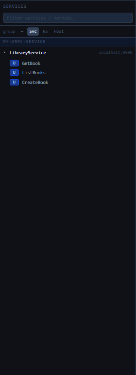
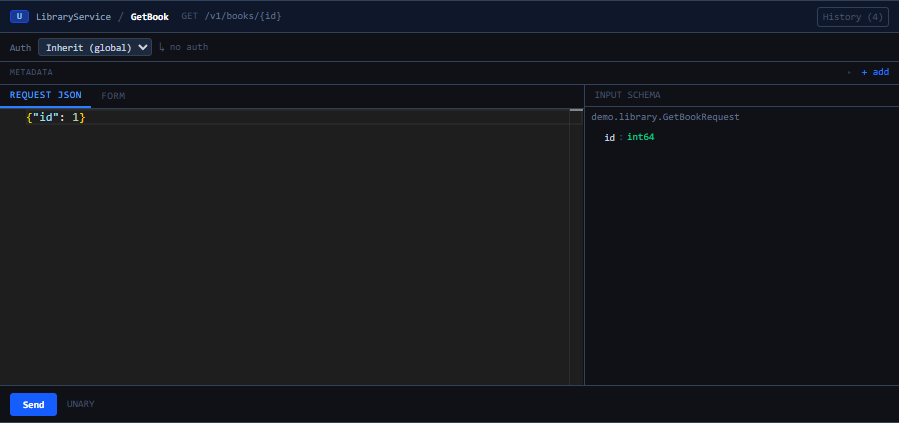
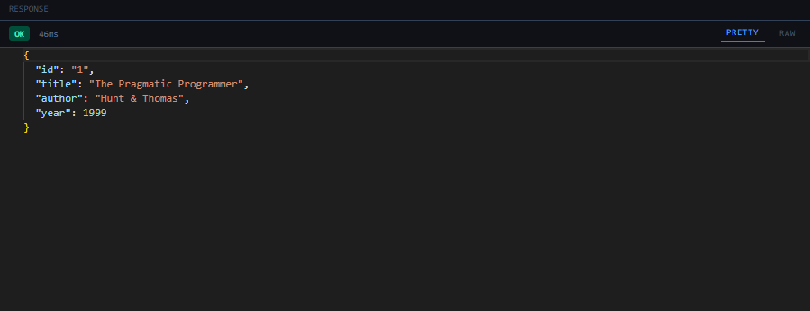
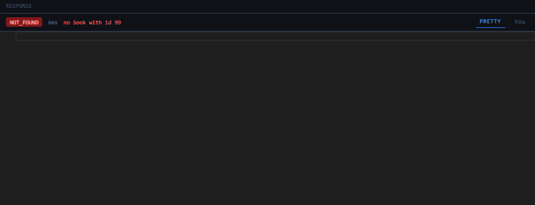
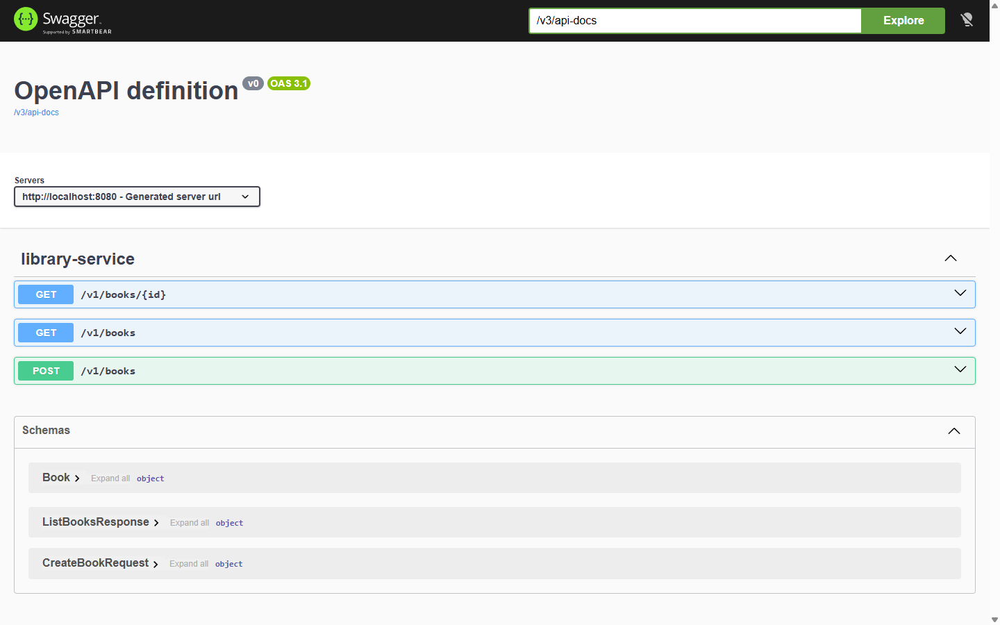
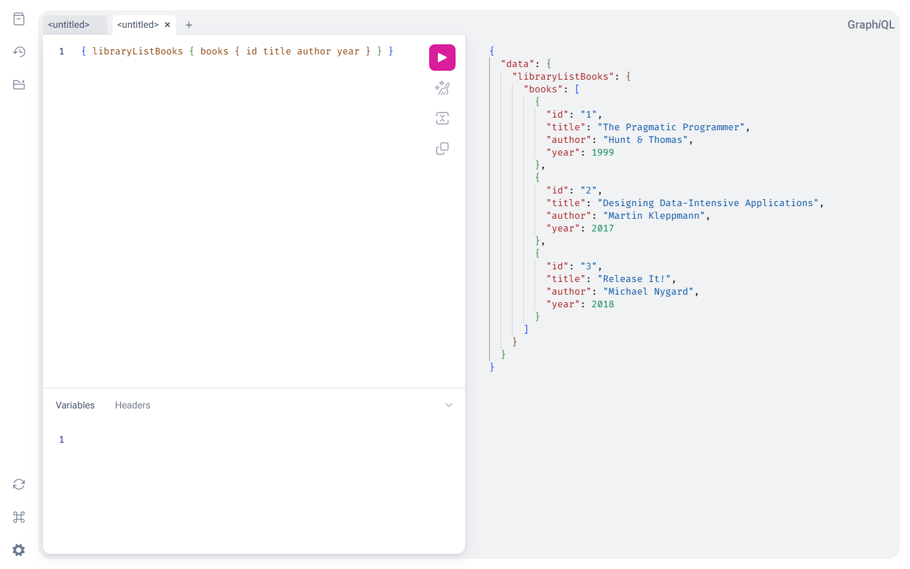

# gRPC web console (`/grpc-ui`)

The embedded try-it console for every gRPC method the gateway has discovered — no protoc,
no grpcurl, no client code. Ships with the `shiguchi-ui-*-starter` modules and mounts at
`shiguchi.ui.path` (default `/grpc-ui`).

> [!WARNING]
> The console can invoke **any** wired method. It is disabled by default
> (`shiguchi.ui.enabled=false`); enable it only inside a trusted network or behind
> auth (`shiguchi.ui.require-auth=true` or `security.surfaces.ui.require-auth=true`,
> both need an OAuth2 JWT resource server). See [../SECURITY.md](../SECURITY.md).

## Service tree



- Every discovered backend appears with its services and methods; the badge marks the
  call type (`U` unary, streaming types accordingly).
- A **client-streaming** method shows a message list under the request editor: the editor holds
  the first message, **+ message** adds the ones after it, and invoking sends them all on one
  call and shows the backend's single response.
- **Filter** box narrows services/methods as you type.
- **group** toggles regroup the tree: flat (`—`), by service (`Svc`), by proto namespace
  (`NS`), or by backend host (`Host`) — useful when the gateway fronts many backends.
- The header shows the pass-through proxy port when `shiguchi.grpc.enabled=true` and
  links to the other surfaces (Swagger UI, GraphiQL).

## Invoking a method

Selecting a method opens the invoke view:


### The request



Working top to bottom:

- **Binding header** — call type, `Service / Method`, and the HTTP binding derived from
  the proto's `google.api.http` annotation (`GET /v1/books/{id}` here). **History** keeps
  recent calls per method for one-click replay.
- **Auth** — inherit the global session token (set once via the header **Auth** button)
  or paste a per-call bearer token. The active choice is echoed next to the selector
  (`↳ no auth` above).
- **Metadata** — `+ add` attaches arbitrary gRPC metadata to the call, e.g.

  | key | value |
  | --- | --- |
  | `x-tenant-id` | `acme` |
  | `x-request-id` | `req-42` |

- **Request** — proto3 JSON for the input message (`REQUEST JSON` tab, schema-aware
  editor), or the **Form** tab for field-by-field input. The form uses pickers for
  `Timestamp` (date-time), `google.type.Date` (date) and `google.type.TimeOfDay` (time) fields,
  which travel as the ISO text described in [json-types.md](json-types.md). For `GetBook`
  (`demo.library.GetBookRequest`) the request is simply:

  ```json
  {"id": 1}
  ```

  The **INPUT SCHEMA** panel on the right shows the message structure with field types
  (`id : int64`), so you never need the `.proto` file open. Note the proto3 JSON rules:
  int64 accepts a number or a string, field names accept camelCase or snake_case.

### The response

**Send** invokes through the gateway's dynamic dispatch — the same serde and metadata
path REST requests take. A successful call shows the gRPC status, server latency, and
the decoded response message as pretty or raw JSON:



```json
{
  "id": "1",
  "title": "The Pragmatic Programmer",
  "author": "Hunt & Thomas",
  "year": 1999
}
```

(`id` is a string in JSON because proto3 maps int64 → JSON string.)

### Errors

gRPC failures render with the status code, latency, and the server's status description —
here `GetBook` with `{"id": 99}`:



The same call through the REST surface would map to HTTP 404 with the gateway's error
body (`{"code":"NOT_FOUND","message":"no book with id 99"}`) — see
[error-handling.md](error-handling.md) for the full mapping.

When the backend attaches `google.rpc.Status` details to the failure (a `BadRequest` with
field violations, an `ErrorInfo`, a `RetryInfo`, one of its own message types), the console
lists them under the status line, one block per detail headed by its type. A streaming call
that fails part-way keeps the chunks received so far and shows the failure the same way.

## The other browser surfaces

The console links to the gateway's sibling surfaces for the same services:

**OpenAPI / Swagger UI** (`/swagger-ui.html`, from `shiguchi-openapi-*-starter`) — every
`google.api.http` binding becomes an OpenAPI 3 operation with schemas generated from the
proto messages:



**GraphQL / GraphiQL** (`/graphiql`, from `shiguchi-graphql-*-starter`) — methods become
queries/mutations (from `(shiguchi.api.graphql)` annotations, or convention-named like
`libraryListBooks` when unannotated):



## Push

With the push surface on ([push.md](push.md)), a **Push** button in the top bar switches the
console to its admin views: the instance overview and namespaces, the topics with a live tail,
the open connections with disconnect, and a test publish. They read the `gateway-push` actuator
endpoint, so it must be exposed; the writes carry the console's global auth token.

## Configuration

| Property | Default | Meaning |
| --- | --- | --- |
| `shiguchi.ui.enabled` | `false` | Mount the console |
| `shiguchi.ui.path` | `/grpc-ui` | Base path |
| `shiguchi.ui.require-auth` | `false` | Require an authenticated principal for the whole UI surface (alias of `security.surfaces.ui.require-auth`) |

The console works with every discovery mode (`DYNAMIC` reflection, `STATIC` classpath
stubs, `PB_FILE`). Method visibility respects `services[].include-methods` /
`exclude-methods` filters.
